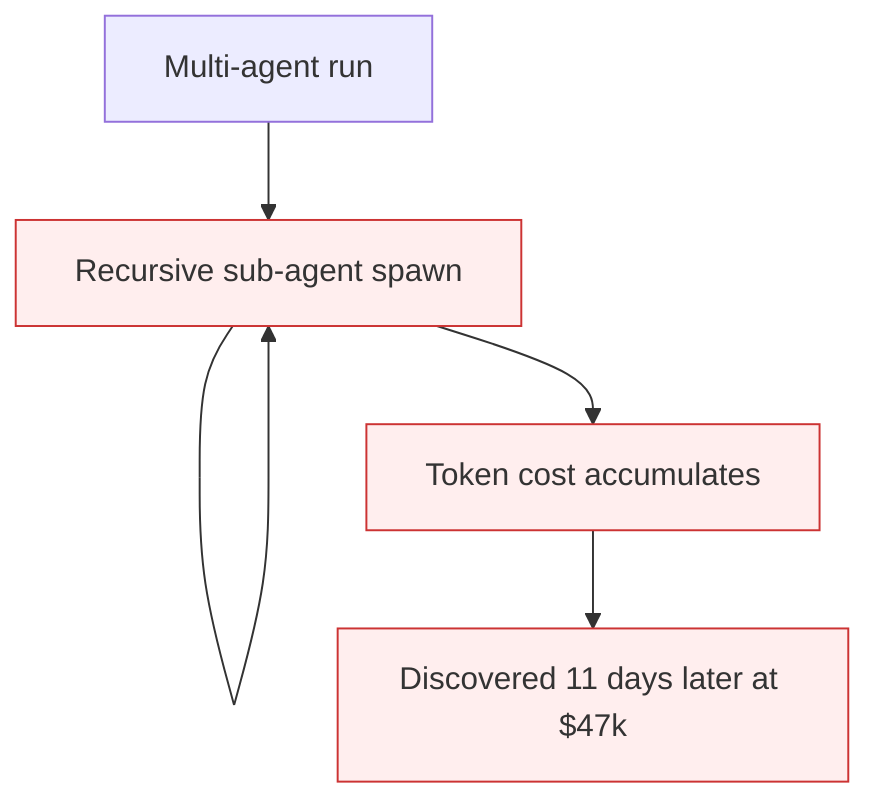

# Token-Economy Blindness

**Also known as:** No Per-Run Cost Cap, Cost-Blind Multi-Agent Loop

**Category:** Anti-Patterns  
**Status in practice:** deprecated

## Intent

Anti-pattern: operate multi-agent loops with no per-run token budget or alarm, allowing recursive loops to silently accumulate $10k+ in undetected costs.

## Context

A team runs a multi-agent research or analysis tool that recursively spawns sub-agents. There are no per-run cost ceilings, no per-tenant alarms, and the model gateway has no anomaly detection on token velocity. The 2026 German t3n incident report documents an 11-day undetected $47,000 runaway from a 4-agent recursive loop.

## Problem

Cost can accumulate to five figures before anyone notices. Discovery happens via the monthly invoice, not via the system. Distinct from existing cost-observability (which is the positive pattern) and unbounded-loop (which is control-flow): this names the *cost-monitoring absence*, the failure to attach an economic ceiling per logical run.

## Forces

- Multi-agent recursive loops are useful — capping them too tight defeats the point.
- Per-run budgeting requires routing every call through a billing-aware gateway.
- Token bursts look like normal usage until they exceed thresholds nobody set.

## Therefore

Therefore: every multi-agent run carries an explicit token (or dollar) budget, gateway-enforced; runs that approach the budget pause for confirmation or terminate; anomalous token velocity at the gateway alarms in real time.

## Solution

Route every model call through a metering gateway that tracks tokens per run id. Set per-run budgets matched to expected output shape. Enforce hard termination at budget exhaustion. Alarm on velocity anomalies (e.g. tokens-per-minute exceeding mean+3σ for the run class). Pair with cost-observability (positive pattern) and step-budget.

## Structure

```
Anti-pattern: Multi-agent loop -> model calls with no metering per run -> recursive loop accumulates cost -> found on invoice. Corrected: Model calls -> metering gateway (tokens per run id) -> per-run budget + hard stop + velocity alarm.
```

## Diagram



## Example scenario

A 4-agent research tool spawns sub-agents recursively. A loop forms in the planner. Each sub-agent costs $0.30. The loop runs for 11 days. Final invoice line: $47,000. The gateway logs the calls but has no per-run budget enforcement and no velocity alarm.

## Consequences

**Benefits**

- Short-term: skipping a metering gateway keeps the architecture simple and the first runs look cheap.
- Naming it lets a team treat a missing per-run economic ceiling as a gap in its own right.

**Liabilities**

- Five-figure undetected runaways from recursive loops.
- Discovery via monthly invoice, not via the system.
- Postmortem reveals the run completed normally from the agent's perspective — no error signal.

## Failure modes

- Invoice discovery — a recursive loop runs up a large cost that is found only on the monthly invoice.
- Normal-looking run — the run finishes without error from the agent's point of view, so nothing alerts.
- No per-run ceiling — tokens are counted in total, but no run has its own budget or stop point.
- Missed velocity spike — tokens per minute jump far above normal, and no alarm watches for it.

## What this pattern constrains

No useful constraint; the missing constraint is per-run economic ceilings with gateway enforcement.

## Applicability

**Use when**

- Never. Cite when reviewing multi-agent recursive systems.
- Set per-run budgets and gateway-enforce termination at exhaustion.
- Alarm on token-velocity anomalies in real time.

**Do not use when**

- Any multi-agent system without per-run budget enforcement.
- Any gateway without anomaly detection on token velocity.
- Any team that discovers cost overruns via monthly invoice.

## Components

- Multi-agent recursive runner — can spawn unbounded sub-agents
- Metering gateway — tracks tokens but enforces nothing
- Missing per-run budget — would terminate at exhaustion
- Missing velocity alarm — would surface runaway in minutes

## Tools

- Detection signal — monitors or audits that surface this anti-pattern in the wild
- Mitigation pattern infrastructure — the positive pattern that resolves this anti-pattern
- Incident-response playbook — what to do when the anti-pattern fires

## Evaluation metrics

- Incident rate — occurrences per period
- Mean time to detection — how long the anti-pattern runs unobserved
- Cost / damage per incident — measurable impact of each occurrence

## Known uses

- **[t3n: KI-Agenten scheitern nicht am Modell ($47k undetected loop)](https://t3n.de/news/ki-agenten-scheitern-an-architekturfehlern-1730278/)** _available_

## Related patterns

- _alternative-to_ **Cost Observability**
- _alternative-to_ **Cost Gating**
- _complements_ **Step Budget**
- _complements_ **Unbounded Loop**
- _complements_ **Missing max_tokens Cap**
- _complements_ **Deliberation Over Observation** — That entry caps spend; this one names a quality inversion, where the agent uses few steps and many tokens and bounding the budget happens to raise accuracy rather than only lower the bill.

## References

- [KI-Agenten scheitern nicht am Modell](https://t3n.de/news/ki-agenten-scheitern-an-architekturfehlern-1730278/) — 2026
