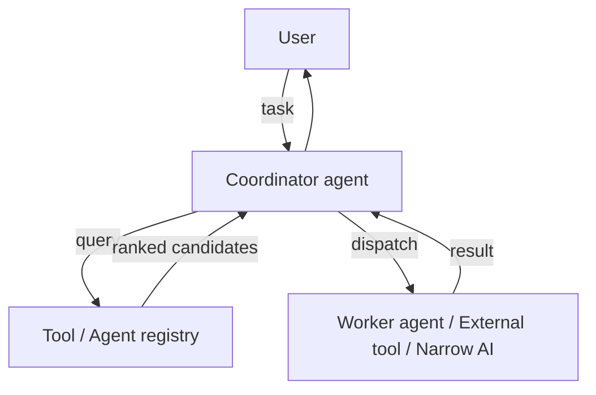

# Tool/Agent Registry

**Also known as:** Capability Catalogue, Agent Marketplace, Tool and Agent Directory

**Category:** Tool Use & Environment  
**Status in practice:** emerging

## Intent

Maintain a single queryable catalogue of both available tools and available agents, with metadata (capability, cost, latency, quality) the agent can use to pick the right one for a task.

## Context

A team runs a coordinator agent that has to pick between many tools and many specialist agents per task: three speech-to-text services with different prices and accuracies, two summariser agents with different domain strengths, several search tools with overlapping coverage. Tools and specialists evolve independently and some are supplied by third parties, so the coordinator should not be hardcoded to specific implementations.

## Problem

If the coordinator's tool palette and the list of available specialist agents are hardcoded into prompts, every new capability requires a redeploy and selection logic gets duplicated everywhere. Keeping tools and agents in separate registries leads to two parallel selection paths with diverging metadata: cost, latency, capability, and quality may be tracked one way for tools and a different way for agents, so the coordinator cannot meaningfully rank candidates across the two.

## Forces

- Discoverability: tools and agents are diverse and hard to enumerate manually.
- Efficiency: selection must happen within the request's latency budget.
- Tool appropriateness: the right pick depends on capability, price, context window, and quality.
- Centralisation: a central registry is a vendor-lock-in and single-point-of-failure risk.

## Therefore

Therefore: publish tools and agents under one registry with uniform capability/cost/quality metadata, and have the agent query that registry at task time, so selection is data-driven and the underlying implementations can change without touching the agent.

## Solution

Provide a registry that exposes a queryable catalogue of (1) tools — typed inputs/outputs, cost, latency, allowed contexts — and (2) agents — capability descriptions, supported tasks, model and provider, price. The agent queries the registry per task, ranks candidates by suitability, and dispatches. The registry can be backed by a coordinator agent with a curated knowledge base, a blockchain smart contract, or extended into a marketplace; metadata stays small (descriptions and attributes), not full schemas, to keep the registry lightweight.

## Structure

```
Agent-as-coordinator → query registry → Tool/Agent registry (metadata catalogue) → return ranked candidates → Coordinator dispatches to Agent-as-worker / External tool / Narrow-AI model.
```

## Diagram



*A single registry catalogues both tools and agents with selection metadata.*

## Example scenario

A coordinator agent receives a task: "transcribe a customer call and summarise the action items". It queries the tool/agent registry, which returns three speech-to-text tools (ranked by per-minute cost and latency for English audio) and two summariser agents (ranked by quality on call-centre data). The coordinator picks the cheapest speech-to-text that meets latency and the highest-quality summariser, dispatches both, and assembles the result.

## Consequences

**Benefits**

- Discoverability: one place to find capabilities.
- Efficiency: ranking by attributes (price, performance, context window) saves time.
- Tool appropriateness: the right pick per task, not the same hardcoded set every time.
- Scalability: lightweight metadata scales to many entries.

**Liabilities**

- Centralisation: registry becomes a vendor lock-in and single point of failure.
- Overhead: maintaining accurate metadata costs effort.
- Trust: registry entries may misrepresent capability — selection must validate.

## Failure modes

- Overstated capability — a registry entry claims a skill the tool or agent does not have, and the coordinator dispatches work it cannot do.
- Stale metadata — cost or latency figures are not updated, and ranking keeps picking a candidate that has become slow or expensive.
- Registry outage — the catalogue is down, and the coordinator has nothing it is allowed to call.
- Lock-in by catalogue — every selection depends on one registry owner, and replacing it means rewiring all agents.

## What this pattern constrains

The agent cannot use off-registry tools or agents at runtime; selection is bound to the catalogue.

## Applicability

**Use when**

- Many tools and/or agents are available and selection is non-trivial.
- A central catalogue (internal or external marketplace) can be maintained.
- Selection metadata (cost, quality, context window) actually changes the pick.

**Do not use when**

- Tool palette is small and stable — hardcoding is simpler.
- Centralised registry adds unacceptable single-point-of-failure risk and a federated discovery surface fits better.

## Components

- Registry Service — queryable catalogue of tools and agents with capability, cost, latency, and quality metadata
- Coordinator Agent — queries the registry per task, ranks candidates, and dispatches
- Tool Entry — typed inputs and outputs, cost, latency, allowed contexts
- Agent Entry — capability description, supported tasks, model and provider, price
- Dispatch Layer — routes the task to the chosen worker agent or external tool

## Tools

- Service registry backend (etcd, Consul, or custom database) — stores tool and agent entries
- Capability search index — ranks candidates against task descriptions
- Pricing and latency telemetry — feeds metadata that ranking depends on

## Evaluation metrics

- Selection precision — fraction of tasks routed to a capability that actually fits
- Registry-to-runtime drift — mismatches between advertised metadata and observed behaviour
- Time-to-onboard a new capability — delay from registration to first successful dispatch
- Cost-aware selection lift — dollar saving from picking cheaper sufficient capabilities
- Ranking latency per query — time the coordinator spends in the registry per task

## Known uses

- **GPTStore** _deprecated_ — Cited by Liu et al. (2025) §4.16 — catalogue for searching ChatGPT-based agents. GPTStore site (gptstore.ai) no longer resolves; the GPT Store marketplace lives on within ChatGPT itself.
- **TPTU (Ruan et al. 2023)** _available_ — Incorporates a toolset to broaden the capabilities of AI agents.
- **VOYAGER (Wang et al. 2023c)** _available_ — Stores action programs and incrementally builds a skill library for reusability.
- **OpenAgents (Xie et al. 2023)** _available_ — Manages API invocation of plugins.

## Related patterns

- _specialises_ **Tool Discovery**
- _uses_ **Model Context Protocol**
- _composes-with_ **Inter-Agent Communication**
- _complements_ **Skill Library**
- _complements_ **Mixture of Experts Routing**
- _used-by_ **Voting-Based Cooperation**
- _complements_ **MCP Bidirectional Bridge**
- _complements_ **Agent Adapter**
- _generalises_ **Vickrey Auction Allocation**
- _complements_ **Agent Capability Manifest** — A registry aggregates many agent capability manifests into one queryable catalogue.
- _alternative-to_ **Agent Sprawl** — A reconciled registry of agents and their owners is the structural inventory whose absence lets a fleet sprawl unaccounted-for.

## References

- [Agent design pattern catalogue: A collection of architectural patterns for foundation model based agents](https://doi.org/10.1016/j.jss.2024.112278) — Yue Liu, Sin Kit Lo, Qinghua Lu, Liming Zhu, Dehai Zhao, Xiwei Xu, Stefan Harrer, Jon Whittle, 2025
