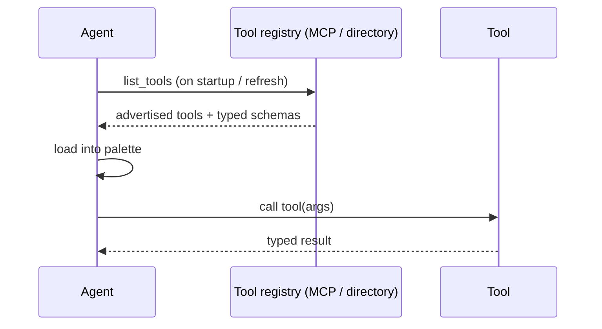

# Tool Discovery

**Also known as:** Capability Advertisement, Dynamic Tool Loading

**Category:** Tool Use & Environment  
**Status in practice:** emerging

## Intent

Let the agent discover available tools at runtime rather than hardcoding the tool list at agent build time.

## Context

A team runs an agent whose tool palette changes faster than its release cycle: new internal capabilities ship weekly, partner integrations come and go, and there is a directory (an MCP server, an internal registry) that already advertises tools with typed schemas. The team wants the agent to learn about new capabilities without rebuilding and redeploying the agent itself.

## Problem

Hardcoding the tool list at build time means every new capability needs a code change and a redeploy of the agent, even when the underlying tool is fully ready to go. Multiple agents in the same organisation drift out of sync because each one was last redeployed at a different moment. Without a runtime mechanism for discovery, the agent simply cannot reach tools that landed after its last release.

## Forces

- Discovery latency adds to every cold start.
- Tool quality varies; not every advertised tool should be exposed.
- Versioning of advertised tools.

## Therefore

Therefore: query a tool registry at startup (or on refresh) instead of hardcoding the palette, so that new tools become available without redeploying the agent.

## Solution

On startup (or periodically), the agent queries a tool registry (MCP server, internal directory). The registry returns advertised tools with typed schemas. The agent loads them into its palette. Optionally cached and refreshed.

## Structure

```
Agent --list_tools (startup / refresh)--> Tool registry (MCP server / directory) --advertised tools + typed schemas--> Agent (loads into palette) --call(args)--> Tool --typed result--> Agent
```

## Diagram



## Example scenario

An agent's tool palette is hardcoded at build time and every new internal capability needs a redeploy of the agent. The team moves to runtime tool discovery: on startup the agent queries an internal MCP-style registry, loads advertised tools with typed schemas, and refreshes periodically. New capabilities ship by registering a tool, no agent redeploy, and the schema-typed advertisement protects against drift between agent and tool.

## Consequences

**Benefits**

- Capability expansion without agent redeploy.
- Multiple agents can share an evolving tool layer.

**Liabilities**

- Discovery failure modes (registry down).
- Trust: should the agent use any advertised tool?

## Failure modes

- Registry down at startup — the agent boots with an empty palette and cannot do its job until the next refresh.
- Untrusted tool loaded — the registry advertises a tool from an unvetted source, and the agent calls it like any other.
- Stale cache — the cached tool list misses a newly added tool, or still lists a removed one that fails on call.
- Schema change mid-session — a tool's schema is updated after discovery, and the agent keeps sending the old arguments.

## What this pattern constrains

The agent's tool palette at any moment is exactly the discovered set; off-registry tools are forbidden.

## Applicability

**Use when**

- Tool palettes evolve and redeploys per new capability are a drag.
- A registry (MCP server, internal directory) advertises tools with typed schemas.
- The agent can refresh its palette safely at runtime.

**Do not use when**

- The tool set is fixed and small enough to hardcode.
- Dynamic discovery introduces unacceptable latency or trust risk.
- No registry exists and building one is more cost than benefit.

## Components

- Tool Registry — MCP server or internal directory that advertises available tools
- Agent — queries the registry on startup or periodically and loads tools into its palette
- Discovery Cache — optional store that keeps the last-known tool list and refresh metadata
- Schema Loader — validates and binds advertised JSON-Schema definitions into callable tools

## Tools

- MCP server or internal HTTP directory — exposes the list_tools endpoint
- JSON-Schema validator — guards typed argument and result shapes at load time
- Cache with TTL — avoids hammering the registry on every cold start

## Evaluation metrics

- Tool-discovery hit rate — fraction of needed tools the agent actually finds in the registry
- Registry refresh latency — time from registry change to agent palette update
- Schema-validation failure rate — share of advertised tools rejected as malformed
- Cross-agent drift — how often two agents see different tool lists at the same moment
- Discovery-induced cold-start latency — added time agents spend at startup

## Known uses

- **MCP server discovery** _available_
- **OpenAI plugin manifests (deprecated)** _available_
- **[Sparrot](https://marco-nissen.com/sparrot/)** _available_ — Available tools are discovered at runtime from the on-disk skill folder and from connected MCP servers, not hard-coded at startup, so adding a skill is a filesystem operation rather than a code change.

## Related patterns

- _generalises_ **App Exploration Phase**
- _complements_ **Awareness**
- _uses_ **Model Context Protocol**
- _complements_ **Tool Loadout**
- _complements_ **Tool Search Lazy Loading**
- _specialises_ **Tool Use**
- _alternative-to_ **Toolformer**
- _complements_ **WebAssembly Skill Runtime**
- _generalises_ **Tool/Agent Registry**
- _alternative-to_ **Synthetic Filesystem Overlay**
- _complements_ **Decentralized Agent Network**
- _complements_ **Agent Adapter**
- _complements_ **On-Demand Tool Synthesis** — Discovery finds existing tools; synthesis creates one when discovery finds nothing that fits.
- _complements_ **Semantic-Layer Query Guardrail** — The semantic layer presents the catalogue of vetted metrics and dimensions as the agent's selectable surface, so the agent discovers and picks from modelled metrics rather than free-authoring against the raw schema.
- _complements_ **Agent-Readable Commerce Surface** — Tool discovery lets an agent find callable tools; the commerce surface is the provider-side mirror — designing the service so agent buyers can find and call it.

## References

- [Model Context Protocol Specification](https://modelcontextprotocol.io/specification)
- [Agent design pattern catalogue: A collection of architectural patterns for foundation model based agents](https://doi.org/10.1016/j.jss.2024.112278) — Yue Liu, Sin Kit Lo, Qinghua Lu, Liming Zhu, Dehai Zhao, Xiwei Xu, Stefan Harrer, Jon Whittle, 2025
