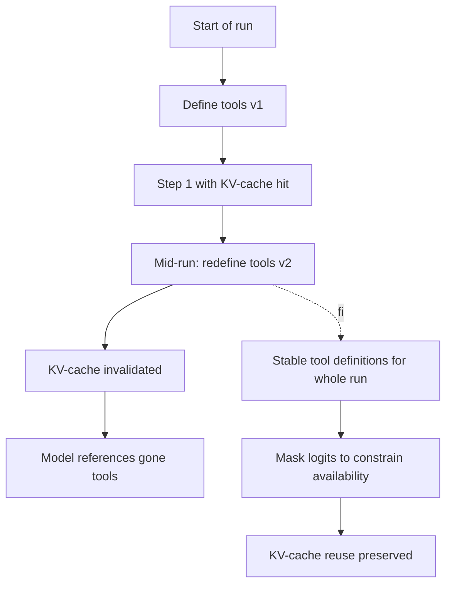

# Tool Loadout Hot-Swap

**Also known as:** Mid-Run Tool Set Mutation, Dynamic Tool Definitions Mid-Iteration, Reshuffling Tools During a Task

**Category:** Anti-Patterns  
**Status in practice:** deprecated

## Intent

Anti-pattern: add or remove tool definitions during a running task so the tool set the model sees changes from turn to turn.

## Context

A team is using an agent framework that grows or shrinks its tool palette dynamically during a run — exposing new MCP (Model Context Protocol) servers as the task moves into new territory, removing tools as conditions change, or swapping the registry between iterations of the loop. From the framework's perspective this looks like good hygiene against tool-explosion: only show the agent the tools it currently needs.

## Problem

Mutating tool definitions in the middle of a running task invalidates the prefix key-value cache for everything in the conversation that came after the change, because the model conditions on the original system message and tool list. The agent then becomes uncertain which tools it can still call: recent turns may reference tools that have just been removed, or tools the model has not yet been told about, leading to hallucinated calls and broken composition between steps. The cost of the cache invalidation also shows up as a latency spike on the very next turn. Hot-swapping the loadout mid-run trades a small inventory benefit for serious correctness and performance damage.

## Forces

- Tool palettes feel like they should grow with the task as new affordances become relevant.
- Removing tools mid-run looks like good hygiene against tool-explosion.
- Modern LLM serving relies on prefix KV-cache reuse; any change above the cursor invalidates it.
- The model conditions on the system message and earlier turns; redefining tools makes those conditioning tokens contradict the present state.

## Therefore

Therefore: keep the tool definitions stable across the run and constrain availability by masking token logits during decoding, so that KV-cache reuse is preserved and the model is never asked to reason against a moving tool registry.

## Solution

Don't mutate tool definitions mid-task. Define the tool palette once at the start of a run and keep it stable. To constrain what the model is allowed to call in a given state, mask the corresponding tool-name token logits during decoding (or use response prefill) instead of removing the tool. See tool-loadout (pick the subset at run start, not mid-run), tool-search-lazy-loading (discover tools without redefining the registry), prompt-caching (KV-cache reuse depends on stable prefixes).

## Structure

```
Anti-pattern: Run start (tool set A) -> mid-task registry change (tool set B) -> cache invalidated + calls to missing tools. Corrected: Run start (fixed tool palette) -> per-state logit masking or prefill -> stable prefix cache and valid calls.
```

## Diagram



## Example scenario

A research agent dynamically attaches MCP servers as new domains become relevant during a long-running task. Each attachment redefines the tool list mid-run; KV-cache hit rate drops to near zero and per-step latency triples. Worse, the agent occasionally tries to call a tool that was just unmounted, because earlier turns referenced it. The team switches to a stable loadout for the whole run plus logit masking to constrain which tools are callable in a given state. KV-cache reuse returns and the contradictory tool references disappear.

## Consequences

**Benefits**

- Short-term: swapping tools in and out looks like a tidy way to keep the visible tool list small and relevant to the current step.
- Naming it lets a team set a simple rule in review: the tool palette is fixed per run, and availability is controlled by masking.

**Liabilities**

- KV-cache is invalidated for all subsequent actions and observations, raising latency and cost.
- The model may emit calls to tools that have just been removed or that did not exist at earlier turns.
- Conditioning tokens from earlier turns now contradict the present tool registry.
- Debugging traces is harder because the apparent tool set changes within a single run.

## Failure modes

- Ghost tool call — the model calls a tool that was removed two turns ago, because earlier turns still mention it.
- Cache wipe — a tool definition changes mid-run, the prefix cache is invalidated, and the next turn shows a sharp latency and cost spike.
- Contradicting context — earlier turns describe one tool set and the current registry shows another, so the model chains steps that no longer fit together.
- Unreadable trace — a reviewer cannot tell which tools the agent could see at a given step, so debugging a bad call takes far longer.

## What this pattern constrains

Avoiding it freezes the palette per run: tool definitions must not change mid-task; availability is constrained by masking tool-name logits at decode time, never by mutating the registry the model has already seen.

## Applicability

**Use when**

- Cite this entry when tools are added or removed while a task is running.
- You are already here if KV-cache invalidations spike and the model keeps calling tools that vanished a turn ago.
- Fix the loadout at run start (tool-loadout) and constrain availability by masking logits during decoding.

**Do not use when**

- Prefix KV-caching is in use — and in any serious deployment it is.
- The agent reasons in chains that reference earlier tool decisions.
- Observability requires a stable tool registry per run.

## Components

- Mid-run tool registry mutation — adds or removes definitions while the conversation is live
- Prefix KV-cache — invalidated above the cursor on every redefinition
- Earlier conversation turns — reference tools that the present registry no longer contains
- Missing logit-mask layer — would constrain callable tools without changing the registry

## Tools

- Dynamic tool-attachment API — mutates the palette during a run instead of at start
- Decode-time logit mask — missing alternative that would gate availability without breaking cache

## Evaluation metrics

- Mid-run tool-definition mutation count — number of registry changes per run; should be zero
- Prefix-KV-cache hit rate after a tool change — collapses to near zero across the next turns
- Calls-to-just-removed-tool count — count of attempts to call a tool that was unmounted in an earlier turn
- Per-step latency spike after mutation — measurable jump on the turn following a registry change

## Known uses

- **[Manus (named as a deliberate design rejection)](https://manus.im/blog/Context-Engineering-for-AI-Agents-Lessons-from-Building-Manus)** _available_ — Manus's context engineering essay states explicitly that dynamic mid-iteration tool additions or removals invalidate KV-cache and confuse the model; Manus uses logit masking via response prefill instead.

## Related patterns

- _alternative-to_ **Tool Loadout**
- _alternative-to_ **Tool Search Lazy Loading**
- _complements_ **Prompt Caching**
- _complements_ **Tool Explosion**
- _complements_ **Tool Over-Broad Scope**
- _complements_ **Progressive Tool Access**

## References

- [Context Engineering for AI Agents — Lessons from Building Manus](https://manus.im/blog/Context-Engineering-for-AI-Agents-Lessons-from-Building-Manus) — Yichao 'Peak' Ji, 2025
