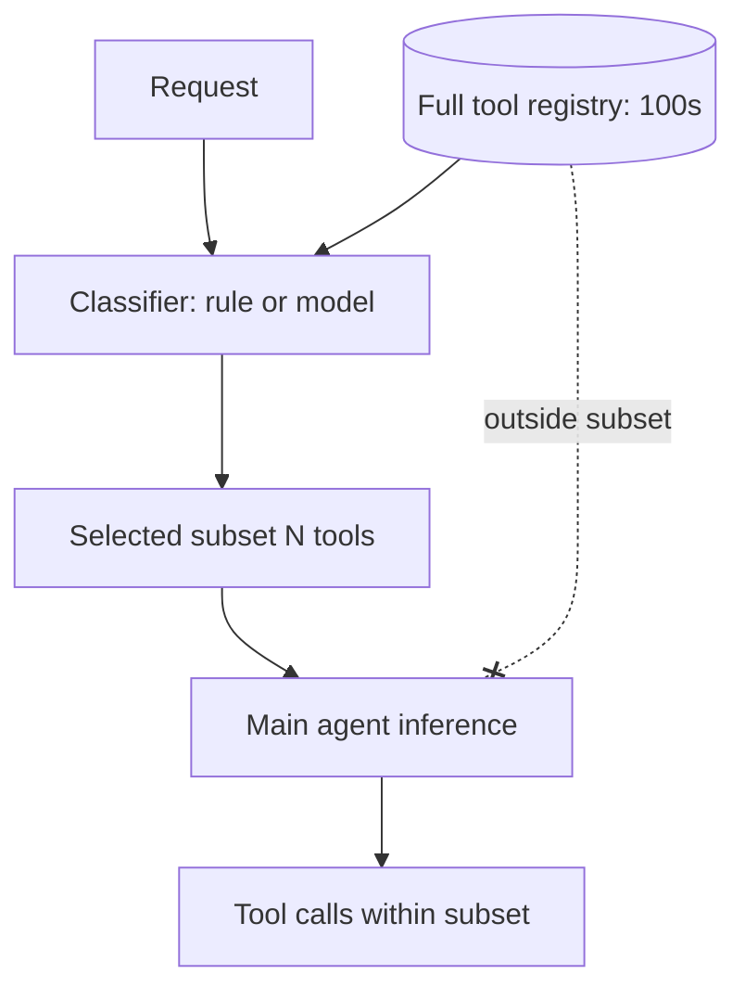

# Tool Loadout

**Also known as:** Tool Subset Selection, Per-Task Tool Filtering, Tool Filter, Limit Exposed Tools

**Category:** Tool Use & Environment  
**Status in practice:** mature

## Intent

Select a small task-relevant subset of available tools per request rather than exposing the full registry to the model.

## Context

A team is running an agent with access to a large tool registry: an MCP catalogue, a plugin marketplace, or an internal directory holding fifty or more tools. Only a handful of those tools are relevant to any single user request, and the team can build a quick classifier (rule-based or model-based) that runs ahead of the main loop.

## Problem

Function-calling accuracy falls off sharply once the model is shown more than roughly twenty tool definitions at once: the model picks the wrong tool, mixes up similarly named ones, or ignores the right tool entirely. Worse, every irrelevant tool definition still consumes context tokens on every call. Exposing the full registry to the main inference is effectively unusable past a certain size, and a static loadout cannot adapt to per-request intent.

## Forces

- Filter quality (does the agent get the right tools?).
- Filter cost (one extra model call per request, or rule-based).
- Tool-discovery latency on each request.

## Therefore

Therefore: classify each incoming request and expose only the N relevant tools to the main inference call, so that the model picks from a focused palette instead of being drowned by the full registry.

## Solution

Before the main loop, classify the request and select N relevant tools (rule-based: by routed lane; or model-based: a quick classifier picks tools). Expose only the selected subset to the agent's main inference call. Tools outside the subset are unavailable for this request.

## Structure

```
Request + full tool registry --> Classifier (rule or model) --> Selected subset (N tools) --> Main agent inference --> Tool calls within subset (tools outside subset unavailable)
```

## Diagram



## Example scenario

A general-purpose agent has access to a 100-tool registry and selection accuracy is poor because the model cannot keep that many tool descriptions in working attention. The team adds a quick classifier ahead of the main loop that picks N relevant tools per request (rule-based by routed lane, or model-based). The agent's main loop now sees only the curated subset; selection accuracy and latency both improve.

## Consequences

**Benefits**

- Function-calling accuracy holds up at scale.
- Token budget for tool definitions stays manageable.

**Liabilities**

- Filter mistakes hide capability the agent could have used.
- Filtering adds latency.

## Failure modes

- Filtered-out tool — the classifier drops the one tool the request needed, and the agent works around it or gives up.
- Misrouted request — the request is classified into the wrong lane, and the agent gets a full loadout of irrelevant tools.
- Loadout too wide — the selected subset is still large, so tool confusion returns.
- Mid-task intent shift — the user's goal changes during the request, and the fixed subset no longer covers it.

## What this pattern constrains

The agent's tool palette is exactly the filtered subset for the current request; tools outside the subset cannot be invoked.

## Applicability

**Use when**

- The tool registry is large (MCP, plugins, internal catalog) and exposing all degrades selection.
- A classifier or rule can pick the relevant subset per request cheaply.
- Function-calling accuracy is a release-gate metric.

**Do not use when**

- The tool set is small and a static palette already works well.
- Per-request classification adds latency that is not earned back in accuracy.
- Subsetting would frequently exclude the tool the agent actually needs.

## Components

- Request Classifier — rule-based or model-based selector that picks N relevant tools per request
- Full Tool Registry — canonical store of every tool the system can expose
- Selected Subset — N-tool palette exposed to the main inference call for this request
- Main Agent — runs against only the selected subset and cannot call tools outside it

## Tools

- Lightweight classifier model — picks the relevant tool subset before the main inference call
- Tool-tagging schema — per-tool labels (lane, capability) that the classifier uses for selection

## Evaluation metrics

- Selection precision and recall against ground-truth-needed tools — how well the classifier scopes the palette
- Task success at varying N — curve of accuracy versus loadout size
- Context tokens saved versus full-registry baseline — prompt-side reduction from a small palette
- Out-of-loadout request rate — share of requests where the right tool was excluded
- Classifier latency — added overhead before the main call begins

## Known uses

- **Claude Code per-task allowed_tools** _available_
- **Cursor contextual tool selection** _available_
- **MCP server filtering** _available_
- **[Sparrot](https://marco-nissen.com/sparrot/)** _available_ — The skill scanner plus a frameworks picker narrow the registered tool surface to a task-relevant subset per tick, so the model never sees the full ~50-skill list when only a handful apply.

## Related patterns

- _complements_ **Agent-Computer Interface**
- _uses_ **Routing**
- _complements_ **Tool Discovery**
- _conflicts-with_ **Tool Explosion**
- _alternative-to_ **Tool Search Lazy Loading** — Loadout selects a fixed subset up front; lazy search loads schemas during the run.
- _alternative-to_ **MCP-as-Code-API**
- _alternative-to_ **Tool Loadout Hot-Swap**
- _complements_ **Agent Adapter**
- _alternative-to_ **Tool Over-Broad Scope**
- _complements_ **Progressive Tool Access**
- _complements_ **Dependency-Aware Skill Retrieval** — Loadout picks a small task-relevant subset; dependency-aware retrieval guarantees that subset also includes the prerequisites the picked skills need.

## References

- [Tool use with Claude](https://docs.claude.com/en/docs/agents-and-tools/tool-use/overview) — 2025
