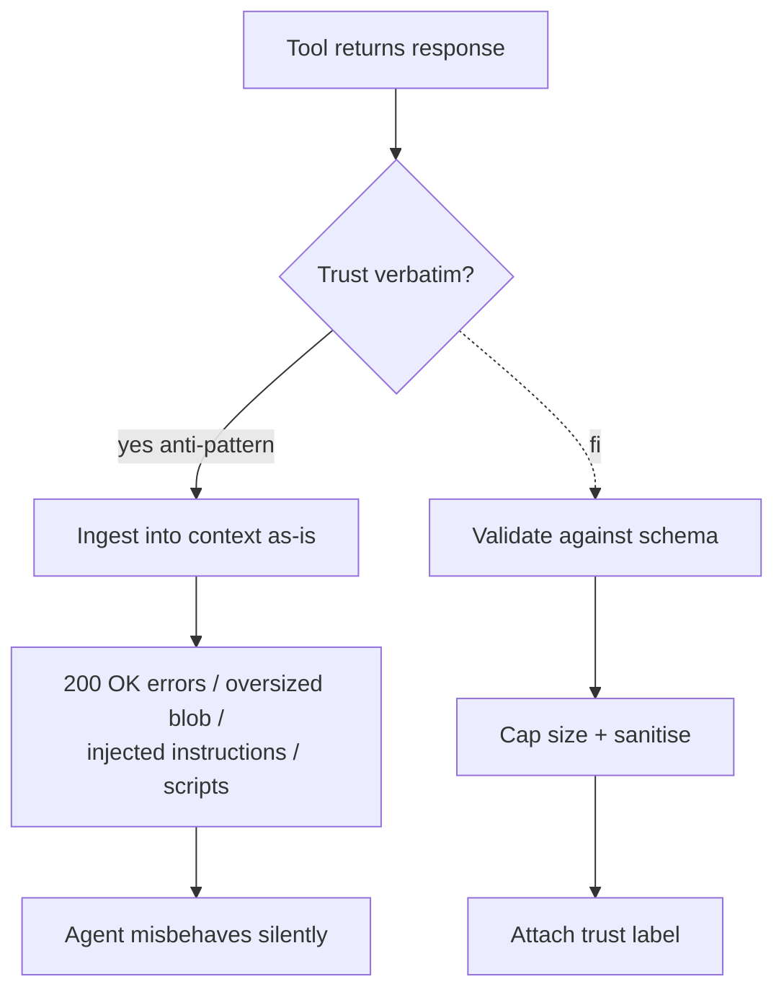

# Tool Output Trusted Verbatim

**Also known as:** Untyped Tool Returns, No Tool Output Validation

**Category:** Anti-Patterns  
**Status in practice:** deprecated

## Intent

Anti-pattern: trust whatever tools return without validation, schema enforcement, or trust labels.

## Context

A team is building an agent that calls tools and then feeds their output back into the model as if it were a fact. The implementation accepts whatever the tool returns at face value: no schema validation, no size limit, no trust labelling, no escape pass over instruction-shaped content. The implicit assumption is that the tool is honest, returns well-formed JSON, and stays within content limits.

## Problem

Real-world tools do not behave that way. They return errors as HTTP 200 OK with a JSON body of {"error": ...} that the agent confuses for a successful result. They return multi-megabyte responses that blow the context window. They return HTML with embedded scripts, or text with embedded prompt-injection payloads instructing the agent to ignore its previous instructions. By trusting every byte of tool output verbatim, the agent loses control over both its context budget and its safety boundary, and a misbehaving or hijacked tool can quietly redirect the agent.

## Forces

- Validation feels like duplicate work when typed function calls exist.
- Schema enforcement requires per-tool work.
- Size limits are tool-specific.

## Therefore

Therefore: at the tool boundary, validate every result against a schema, cap response size, sanitise embedded HTML, and attach a trust label before ingestion, so that 200-OK errors, oversized blobs, and injected instructions cannot silently poison the agent's context.

## Solution

Don't. Validate every tool result against a schema. Cap response size. Sanitise HTML. Apply tool-output-poisoning defenses. See tool-output-poisoning, structured-output, input-output-guardrails.

## Structure

```
Anti-pattern: Tool call -> raw output -> model context -> corrupted state or injection. Corrected: Tool call -> schema check + size cap + sanitise + trust label -> model context.
```

## Diagram



## Example scenario

A team's agent treats every tool response as trusted gospel, with schema validation off, size cap off, no trust labels. Real tools then do what real tools do: a 200 OK with `{error: 'rate limit'}`, a 12MB HTML blob with embedded scripts, a JSON field whose 'description' contains a prompt-injection payload. The agent ingests it all and misbehaves. They stop doing this and validate, cap, sanitise, and apply tool-output-poisoning defenses at the boundary.

## Consequences

**Benefits**

- Short-term: passing tool output straight into context is the fastest way to get a demo working, with no validation code to write.
- Naming it lets a team require a trust boundary at every tool return and check for it in code review.

**Liabilities**

- Silent corruption of agent context.
- Indirect prompt injection succeeds.
- Context overflow from oversized responses.

## Failure modes

- Error read as success — a tool returns HTTP 200 with an error body, and the agent treats the error text as a valid result.
- Context blow-out — a multi-megabyte response is pasted into context and pushes out the task instructions.
- Injected instruction — a page or tool result carries text telling the agent to ignore its instructions, and the agent follows it.
- Quiet redirect — a hijacked tool steers the agent step by step while every call still looks normal in the logs.

## What this pattern constrains

Avoiding it imposes a trust boundary at every tool return: results must not flow into context unvalidated; each one is schema-checked, size-capped, sanitised, and labeled with its trust level before the model reads it.

## Applicability

**Use when**

- Cite this entry when tool results flow into context with no validation layer.
- You are already here if an error page, oversized body, or injected instruction from a tool has steered the agent.
- Validate against a schema, cap response size, sanitise markup, and apply tool-output-poisoning defenses.

**Do not use when**

- Tools are untrusted and content can include adversarial payloads.
- Downstream code assumes valid JSON or bounded sizes.
- Schema validation, size caps, or sanitisation are available.

## Components

- Tool-result ingestion path — feeds whatever the tool returned straight into the model context
- Schema-free response handling — accepts 200 OK with an error body as if it were success
- Missing size cap — lets a multi-megabyte response blow the context window
- Missing trust label — leaves the agent unable to distinguish tool content from instructions

## Tools

- Raw tool response stream — ingested verbatim, including embedded HTML, scripts, or prompt-injection payloads
- Output validator and sanitiser — missing boundary layer that would enforce schema, size, and content rules

## Evaluation metrics

- Schema-validation coverage on tool outputs — fraction of tools whose return is checked against a schema
- 200-OK-but-error rate — share of responses that returned success status with an error-shaped body and were treated as success
- Indirect-prompt-injection success rate — fraction of red-team payloads in tool returns that altered agent behaviour
- Oversized-response context-overflow incidents — count of tool returns that exceeded the configured size cap

## Known uses

- **[GitHub MCP server (Invariant Labs disclosure, 2025)](https://invariantlabs.ai/blog/mcp-github-vulnerability)** _available_ — Public disclosure of a prompt-injection chain where agents trusted issue text fetched through the GitHub MCP server verbatim, enabling exfiltration of private repository data.

## Related patterns

- _alternative-to_ **Tool Output Poisoning Defense**
- _alternative-to_ **Structured Output**
- _alternative-to_ **Input/Output Guardrails**
- _complements_ **Memo-As-Source Confusion**
- _complements_ **Goal Hijacking**
- _complements_ **Control-Flow Integrity**
- _complements_ **False Resolution**
- _complements_ **Silent External-Source Rot** — That anti-pattern is the tool's own return going unvalidated; this one is the wrapped upstream source rotting so even a schema-valid return is empty — the canary here checks content quality, not just shape.
- _complements_ **Tool-Output Arithmetic Trust** — Inverse failure on the same boundary: trusted-verbatim is about over-trusting the tool's content and safety, while this is the agent mis-computing over content the tool returned correctly.
- _complements_ **Tool-Result Reinforcement** — Avoiding the anti-pattern puts a trust boundary at every tool return; tool-result reinforcement reuses that same wrap point to append harness-authored, clearly-delimited orientation rather than untrusted tool bytes.
- _complements_ **Machine-Checkable Tool Contract** — That anti-pattern is the caller failing to validate what comes back; this pattern constrains what the tool promises on the way in and the shape of its failures on the way out.

## References

- [OWASP LLM01: Prompt Injection](https://genai.owasp.org/llmrisk/llm01-prompt-injection/) — 2025
