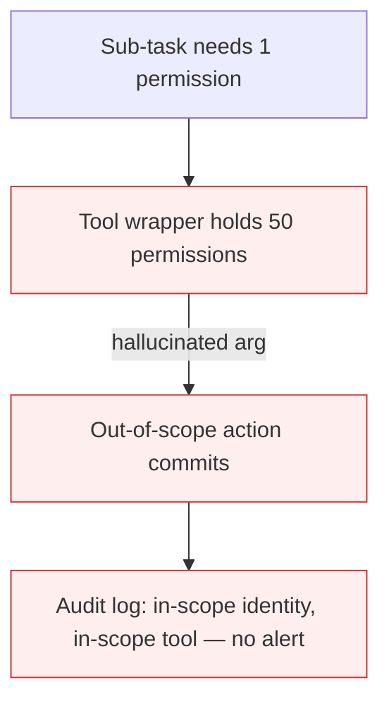

# Tool Over-Broad Scope

**Also known as:** Excessive Tool Permissions, Over-Privileged Tool Loadout

**Category:** Anti-Patterns  
**Status in practice:** deprecated

## Intent

Anti-pattern: grant the agent tools scoped so broadly that a single hallucinated argument can escalate into a privilege incident.

## Context

An agent is shipped with a tool that wraps a high-privilege underlying API (database admin, IAM, payments). The wrapper is given the union of permissions the agent might ever need across all tasks, instead of the minimum the current task needs.

## Problem

The agent now needs only one wrong argument — a wrong table name, a wrong customer id, a wrong amount — for the call to commit damage that the agent had no business doing. Hallucinated tool arguments become privilege escalations. The audit log shows agent identity calling an in-scope tool with in-scope credentials; no permission check fires because the broad scope made the call legal.

## Forces

- Per-task narrow scoping is operationally expensive — provisioning many short-lived credentials adds latency and complexity.
- Hallucinated arguments are not bugs to be eliminated; they are the steady-state failure mode of LLM tool use.
- Broad-scope wrappers are easier to demo and seem more 'capable' to stakeholders.

## Therefore

Therefore: never grant a tool wrapper more authority than the *current task* requires; replace one fat tool with many narrow ones, scoped per task or per session.

## Solution

Narrow tool scope to the smallest unit the task can use: per-resource, per-action, per-tenant. Use just-in-time credential issuance bound to the run id. Prefer many small tools over one configurable mega-tool, so that argument-hallucination cannot widen the blast radius. Pair with tool-loadout-hotswap so the agent sees only the tools relevant to the current sub-task.

## Structure

```
Anti-pattern: Agent -> broad mega-tool (all resources, all actions) -> hallucinated argument -> privileged damage. Corrected: Agent -> small per-resource, per-action, per-tenant tools + just-in-time credentials bound to run id -> damage limited to the task.
```

## Diagram



## Example scenario

A customer-service agent has one `crm_update(customer_id, fields)` tool whose backing IAM role can write every field on every customer. The agent hallucinates a customer id while resolving a ticket and overwrites another customer's billing address. The CRM audit trail shows the agent identity wrote the field — which it had permission to do — so no security alert fires.

## Consequences

**Benefits**

- Short-term: one configurable tool with wide access is quick to build and never blocks the agent.
- Naming it lets a team review each tool for least privilege before granting it to an agent.

**Liabilities**

- Hallucinated arguments commit damage that no human approved.
- Standard audit log shows in-scope identity using in-scope tool — no alert fires.
- Blast radius scales with the union of tool privileges, not with the task.

## Failure modes

- Wrong-table write — the agent hallucinates a table name, and a broad database tool runs the change on production data.
- Wrong-customer action — a wrong customer id or amount goes through because the tool can act on any account.
- Silent audit — the log shows an approved identity using an approved tool, so no alert fires.
- Union blast radius — a mega-tool combining many privileges lets one bad call reach far beyond the current task.

## What this pattern constrains

No useful constraint; the missing constraint is per-task least-privilege at the tool boundary.

## Applicability

**Use when**

- Never. Cite when reviewing agent tool catalogs.
- Replace fat tools with per-action, per-resource narrow tools.
- Issue short-lived credentials bound to a single run id.

**Do not use when**

- Any agent whose tool wrapper has more permissions than the current sub-task strictly needs.
- Tool wrappers backed by long-lived admin credentials.
- Any agent where 'one wrong argument' could damage another tenant.

## Components

- Fat tool wrapper — holds union of permissions across all possible tasks
- LLM argument generator — produces tool arguments that may be hallucinated
- Backing API — commits the action without per-call authorization check
- Missing per-task credential issuer — would have constrained scope

## Tools

- Detection signal — monitors or audits that surface this anti-pattern in the wild
- Mitigation pattern infrastructure — the positive pattern that resolves this anti-pattern
- Incident-response playbook — what to do when the anti-pattern fires

## Evaluation metrics

- Incident rate — occurrences per period
- Mean time to detection — how long the anti-pattern runs unobserved
- Cost / damage per incident — measurable impact of each occurrence

## Known uses

- **[Production agentic workflow 2026 failure taxonomy (digitalapplied.com)](https://www.digitalapplied.com/blog/agentic-workflow-anti-patterns-orchestration-mistakes-2026)** _available_

## Related patterns

- _alternative-to_ **Tool Loadout**
- _complements_ **Tool Loadout Hot-Swap**
- _complements_ **Agent Privilege Escalation** — Names the outcome; tool-over-broad-scope names the design fault that enables it.
- _specialises_ **Authorized Tool Misuse**
- _complements_ **Policy-as-Code Gate**
- _complements_ **Static Role for a Dynamic Agent** — Over-broad tool scope is the per-tool symptom; static-role authorization is the model-level cause that makes broad standing scope the default.
- _complements_ **Tenant-Scoped Tool Binding** — The tenant predicate narrows what an over-broad tool can reach.
- _complements_ **Agent Tool-Invocation Data Black-Box** — Tool-over-broad-scope is excessive permission breadth on a tool; the data black box is the user's inability to see which tools and data services their data is routed through at all.
- _alternative-to_ **Attenuating Delegation Chain** — A per-hop tool facet that can only shrink is how a downstream agent stops inheriting the whole loadout the top of the chain was given.
- _alternative-to_ **Monotonic Privilege Confinement** — There the scope is too wide from the start and stays that way; here the run may only lose scope, though a badly fitted initial policy still leaves that anti-pattern intact.

## References

- [Agentic Workflow Anti-Patterns: Orchestration Mistakes (2026)](https://www.digitalapplied.com/blog/agentic-workflow-anti-patterns-orchestration-mistakes-2026) — 2026
