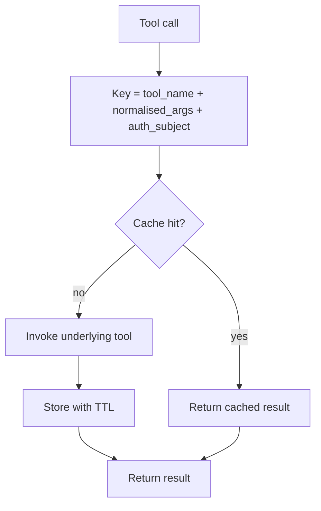

# Tool Result Caching

**Also known as:** Memoised Tools, Idempotent Cache

**Category:** Tool Use & Environment  
**Status in practice:** mature

## Intent

Cache the result of expensive deterministic tool calls keyed by their arguments so repeat calls within a session return immediately.

## Context

A team runs an agent that calls deterministic lookup or computation tools many times within a single task — fetching the same company profile from four sub-tasks, recomputing the same exchange rate, reading the same immutable document for several reasoning steps. The tools are paid (per-call cost), rate-limited, or simply slow, and the agent has no memory of having called them before.

## Problem

Repeat calls on identical arguments pay full latency and full per-call cost every time, even though the result has not changed and the tool author would gladly serve it from a cache. The agent's loop is structured one call at a time and has no awareness of caller history, so the same lookup gets re-fetched whenever a different reasoning step happens to need it. Caches written naively can leak results across users when caller identity is not part of the key.

## Forces

- Cache invalidation: when does the underlying data change?
- Per-user vs global caches differ on isolation guarantees.
- Cache hits hide tool latency the agent might benefit from learning about.

## Therefore

Therefore: wrap deterministic tools in a cache keyed on (tool, normalised args, caller identity) with per-tool TTLs, so that repeat calls return instantly without leaking results across users.

## Solution

Wrap deterministic tools in a cache layered on `(tool_name, normalised_args)`. Set TTLs by tool type. On cache hit, return immediately without invoking the underlying tool. Per-user scoping for tools that read user data; global for read-only public data. Cache keys must include the auth subject (caller identity), not just args; args-only keys leak data when callers change.

## Structure

```
Tool call --> Key (tool_name + normalised_args + auth_subject) --> Cache hit? --yes--> Return cached result; --no--> Invoke tool --> Store with TTL --> Return result
```

## Diagram



## Example scenario

An agent that researches companies calls the same `get_company_profile(domain)` tool four times per session because different sub-tasks need it. Latency and per-call cost stack up. The team wraps deterministic tools in a cache keyed on `(tool_name, normalised_args)` with TTLs by tool type; per-user scoping keeps tenant-sensitive results from crossing accounts. Repeat calls return immediately, the underlying tool quota lasts longer, and session latency drops.

## Consequences

**Benefits**

- Latency drops on repeat calls.
- Cost reduction for paid APIs.

**Liabilities**

- Stale cache hits when underlying data changes.
- Non-deterministic tools cannot be cached safely.

## Failure modes

- Cross-user leak — the key omits caller identity, and one user receives a cached result built from another user's data.
- Stale hit — the underlying data changes inside the TTL, and the agent reasons over an old value.
- Cached non-deterministic tool — a tool that returns different results per call is marked deterministic, and the agent sees a frozen answer.
- Key normalisation gap — the same arguments in a different order or case produce different keys, and the cache rarely hits.

## What this pattern constrains

Only tools declared deterministic may be cached; nondeterministic tools bypass the cache.

## Applicability

**Use when**

- Agents re-call the same tool with the same arguments multiple times within a task.
- Tools are deterministic enough to cache by normalised arguments.
- TTL and per-user vs global scoping can be defined per tool.

**Do not use when**

- Tool results are non-deterministic or time-sensitive (live state).
- Per-user scoping cannot be enforced and shared cache would leak data.
- Repeat-call rate is too low to recover the cache infrastructure cost.

## Components

- Cache Layer — wraps deterministic tools and is keyed by tool name, normalised args, and auth subject
- Key Normaliser — canonicalises arguments so equivalent calls hash the same
- TTL Policy — sets per-tool expiration based on data volatility
- Auth Subject Resolver — attaches caller identity to every cache key to prevent cross-user leaks
- Underlying Tool — invoked only on cache miss; its result is stored before return

## Tools

- Cache store (Redis, Memcached, or in-process LRU) — backs the keyed lookups
- Argument canonicaliser — sorts and normalises JSON to make keys stable
- TTL configuration registry — per-tool expirations applied at write time

## Evaluation metrics

- Cache hit rate per tool — share of calls served without invoking the backend
- Latency reduction on cache hits — how much faster cached returns are than live calls
- Cross-subject leak incidents — cache hits served to a caller other than the original subject (should be zero)
- Staleness complaints — reports where cached data was wrong because the TTL was too long
- Cache memory footprint — storage cost of keeping the hottest results warm

## Known uses

- **Most production agent platforms** _available_
- **[Sparrot](https://marco-nissen.com/sparrot/)** _available_ — Tool results are cached keyed by (tool, args) so repeated calls within a tick or across nearby ticks reuse the prior result instead of paying the latency / cost again.

## Related patterns

- _specialises_ **Tool Use**
- _complements_ **Session Isolation**
- _complements_ **Realtime API When Batchable**
- _complements_ **Tool-Result Eviction** — Eviction discards a consumed payload from the live window; caching retains a result for replay. They trade retention against window pressure.
- _alternative-to_ **Semantic Response Cache** — Tool-result caching keys on exact (tool, normalised args); the semantic cache keys on embedding similarity rather than an exact match.
- _complements_ **Execution-State Ledger** — Caching reuses results keyed by arguments and a time-to-live for tools declared deterministic; here reuse is keyed by whether the run's own later writes have superseded what the earlier call read.

## References

- [Prompt caching](https://docs.claude.com/en/docs/build-with-claude/prompt-caching) — 2025
