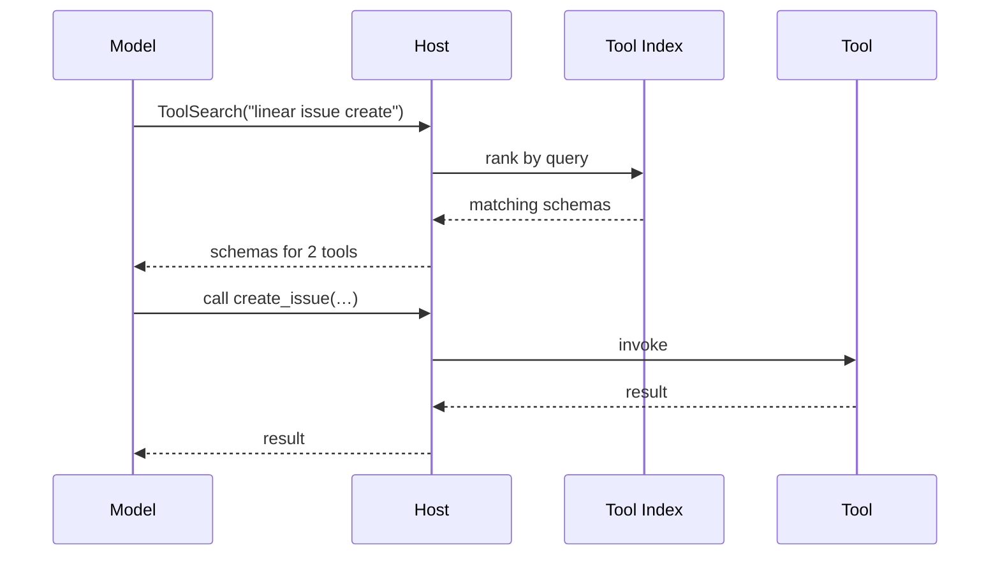

# Tool Search Lazy Loading

**Also known as:** Lazy Tool Loading, On-Demand Tool Schema Loading, ToolSearch Primitive

**Category:** Tool Use & Environment  
**Status in practice:** emerging

## Intent

Defer loading tool schemas into the context window until a search step shows they are needed.

## Context

A team is running an agent connected to many Model Context Protocol (MCP) servers, plugin endpoints, or API gateways, where the combined tool catalogue holds fifty or more tools. The full set of tool schemas, if loaded eagerly into the system prompt, would consume a substantial fraction of the context window before the user has even spoken.

## Problem

Injecting every available tool definition into the system prompt up front spends tokens on tools that will never be used in this session, slows every request through the larger prompt, and forces the model to pick a relevant tool out of a long list of mostly irrelevant ones. Static per-request loadouts can help but require choosing the subset before the user's intent is fully known. There is no way to keep a large catalogue discoverable without paying for all of it on every call.

## Forces

- Tool definitions are large; a catalogue of 50+ tools can dominate the prompt budget.
- The model needs enough description to pick the right tool, but only when it is actually about to call one.
- Searching for tools at runtime adds an extra round trip before the first tool call.
- Hidden tools must still be discoverable — otherwise the model behaves as if they do not exist.

## Therefore

Therefore: replace the eager tool list with a search primitive that returns schemas on demand, so that a 50+ tool catalogue stays discoverable without dominating the prompt budget until a tool is actually about to be called.

## Solution

Replace the eager tool list with a single search primitive (for example a ToolSearch tool) that returns matching tool schemas by query. The system prompt lists only the search primitive plus a short index of tool names or categories. When the model decides it needs a tool, it calls the search primitive, receives the full schema for the matching tools, and only then calls the tool by name. Schemas loaded by search are kept in context for the rest of the session so repeat use does not pay the lookup cost again.

## Structure

```
Model --ToolSearch(query)--> Host --> Tool index (rank by query) --matching schemas--> Model (schemas kept for session) --call tool(args)--> Host --> Tool --result--> Model
```

## Diagram



## Example scenario

An assistant is wired to seven MCP servers exposing 60 tools combined. Preloading every schema costs roughly 30k tokens before the user has even spoken. Instead the host advertises only a ToolSearch tool plus a one-line index. When the user asks to file a Linear ticket, the model calls ToolSearch with the query "linear issue create", receives the schema for two relevant tools, and only then calls the real create-issue tool. The other 58 tools never enter the context.

## Consequences

**Benefits**

- Drastic reduction in baseline prompt tokens — only schemas that were searched for occupy context.
- Scales to hundreds of tools without saturating the prompt.
- Search results can rank by recent use, capability tags, or server-supplied hints.
- Tool surface becomes pluggable at runtime; servers can be added without re-templating the system prompt.

**Liabilities**

- Adds one extra tool call before the first real action when the right tool is not already loaded.
- Poor tool descriptions or weak search ranking can cause the model to overlook a relevant tool.
- Stateful — schemas loaded earlier in a session are visible later, which can leak across turns if not pruned.
- Harder to reason about deterministic behaviour because the effective tool surface depends on what was searched.

## Failure modes

- Overlooked tool — a weak description or poor ranking keeps the right tool out of search results, and the model concludes it does not exist.
- Called before loaded — the model calls a tool by a guessed name without searching, and the call fails.
- Session bloat — schemas loaded early stay in context all session, and the prompt grows back toward the eager size.
- Unreproducible runs — two sessions with the same input search differently and end up with different tool surfaces, so behaviour is hard to replay.

## What this pattern constrains

Tool schemas are not in context until the search primitive has returned them; the model may not call a tool whose schema has not yet been loaded by search or preloaded by the host.

## Applicability

**Use when**

- Total tool schemas would otherwise consume more than ~10% of the context window.
- Many tools are available but only a small subset is used per session.
- The host can intercept tool listing and intermediate a search step.

**Do not use when**

- The full tool palette is small enough that an eager list costs little.
- Every session needs the same handful of tools — a static loadout is simpler.
- The host cannot guarantee that the search primitive returns relevant tools (poor metadata, no ranking).

## Components

- Tool Search Primitive — single tool exposed to the model that returns matching schemas by query
- Tool Index — ranked store of tool schemas searchable by name, description, or category
- Schema Loader — fetches and injects matching schemas into context only when the model asks
- Short Tool Categories Index — compact list of tool names or groups kept in the system prompt
- Agent — calls the search primitive first and only then calls the discovered tool by name

## Tools

- Semantic search index over tool schemas — backs the ToolSearch primitive with embedding-based ranking
- Lexical fallback (BM25) — catches exact-name lookups the embedding model misses

## Evaluation metrics

- ToolSearch precision at k — relevance of returned schemas for the model's query
- Context tokens saved versus eager loadout — reduction from keeping schemas off the prompt by default
- Extra-step overhead — added latency from the search-then-call round trip
- Tool-discovery hit rate — share of needed tools the model successfully finds via search
- Search-recall gap — fraction of tasks failing because the right tool was not retrieved

## Known uses

- **[Claude Code ToolSearch primitive](https://modelcontextprotocol.io/)** _available_ — Deferred tool schemas are fetched via a select:/keyword query before the tool itself can be called.
- **[MCP servers with large tool surfaces](https://modelcontextprotocol.io/)** _available_ — Server-side search/index endpoints let clients pull schemas on demand instead of in a single list_tools dump.

## Related patterns

- _alternative-to_ **Tool Loadout** — Loadout selects a fixed subset up front; lazy search loads schemas during the run.
- _complements_ **Tool Discovery** — Discovery finds that a tool exists; lazy loading defers its full schema until needed.
- _uses_ **Model Context Protocol**
- _complements_ **Context Window Packing**
- _complements_ **MCP-as-Code-API**
- _alternative-to_ **Tool Loadout Hot-Swap**
- _alternative-to_ **Dependency-Aware Skill Retrieval** — Lazy loading defers a tool's schema until a search hit; this retrieves the prerequisite closure up front so the loaded bundle is executable.
- _complements_ **Retrieval-Saturation Tool Attack** — Lazy loading retrieves tool schemas on a search hit; retrieval saturation poisons that search so attacker tools occupy the results.

## References

- [Equipping agents for the real world with Agent Skills](https://www.anthropic.com/engineering/equipping-agents-for-the-real-world-with-agent-skills) — Anthropic Engineering, 2025
- [Model Context Protocol specification](https://modelcontextprotocol.io/) — Anthropic & contributors, 2024
- [Thariq Shihipar on lazy MCP tool loading](https://x.com/trq212/status/2011523109871108570) — Thariq Shihipar, 2025
