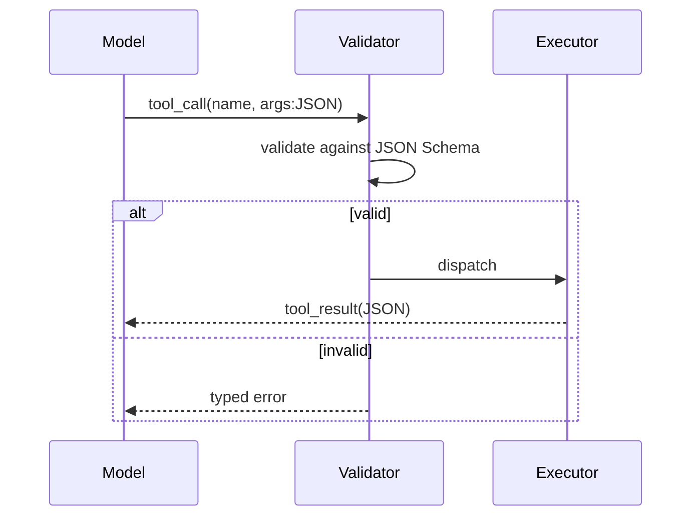

# Tool Use

**Also known as:** Function Calling, Tool Calling, Action Use

**Category:** Tool Use & Environment  
**Status in practice:** mature

## Intent

Let the LLM produce typed calls against an external toolkit instead of producing free-form text the surrounding system has to parse.

## Context

A team is building an agent that has to affect the outside world: read a customer record, cancel an order, write a row to a database, render a chart, post to a channel. The model alone cannot do these things safely or correctly, and the surrounding system needs deterministic, validated operations to act on intent.

## Problem

If the model speaks only free-form text, the host has to parse intent out of prose on every turn: the model invents field names, mis-spells operations, returns half-structured Markdown, or buries the actual command in an explanation. Invalid calls are caught only when downstream code crashes, and audit trails for which operations were attempted have to be reconstructed from natural language. The model is good at expressing intent and weak at producing perfectly typed structure without a schema to validate against.

## Forces

- The model is good at intent, weak at typed structure.
- The host system needs deterministic operations to act.
- Schema rigidity reduces the model's freedom; too much rigidity loses recall.

## Therefore

Therefore: define a typed tool palette and let the model emit JSON-Schema-validated calls instead of free-form text, so that the host executes deterministic operations on intent the model is good at expressing.

## Solution

Define a typed tool palette. The model emits tool calls conforming to a JSON Schema; the host validates and executes; results return as structured tool results. The agent becomes a thin client of a deterministic toolkit.

## Structure

```
Model -> tool_call(name, args:JSON) -> Validator -> Executor -> tool_result(JSON) -> Model.
```

## Diagram



*Tool Use makes the validator the boundary: invalid calls are rejected at the schema layer before any executor runs.*

## Example scenario

A customer-support agent receives 'cancel my order #4471.' Instead of writing free-form text the surrounding code has to parse, it emits a structured call: cancel_order({order_id: '4471'}). A validator checks the call against the API's schema; the executor runs it; the agent gets back {status: 'cancelled', refund_amount: 49.99}. The model never has to guess at field names or formatting.

## Consequences

**Benefits**

- Invalid calls are rejected at the schema layer rather than as runtime errors.
- The toolkit, not the model, is the locus of capability and audit.
- Tools can be tested and versioned independently of prompts.

**Liabilities**

- Tool palette design becomes the bottleneck; bad tools propagate to every call site.
- Models with weaker function-calling support drift; schema strictness must be tuned per model.

## Failure modes

- Bad tool, everywhere — a poorly designed tool in the palette is called from every flow, and its flaw shows up in all of them.
- Schema drift by model — a model with weaker function-calling support emits calls that almost match the schema, and loose validation lets them through.
- Over-strict schema — the schema is so tight that valid intents fail validation, and the agent loops on rejected calls.
- Side-door effect — a code path lets model text change state outside a registered tool, and the audit trail misses it.

## What this pattern constrains

The model cannot affect state except through a registered tool with a typed signature.

## Applicability

**Use when**

- The model must affect external state or query authoritative systems.
- Operations are typed and a JSON Schema can describe them.
- Audit and validation need to live outside the model.

**Do not use when**

- The deliverable is free prose; structuring it as a tool call is overhead.
- The underlying API has no schema and cannot be wrapped cheaply.
- Calls are extremely high-frequency and per-call validation is the bottleneck.

## Components

- LLM — emits typed tool calls instead of free-form text
- Tool Palette — typed catalogue of tools with JSON-Schema arguments and result shapes
- Schema Validator — checks every emitted call against the tool's JSON Schema before dispatch
- Executor — dispatches valid calls to the underlying implementation and returns structured results
- Result Channel — carries typed tool_result messages back into the model context

## Tools

- JSON-Schema validator (ajv, jsonschema) — guards the boundary between model output and execution
- Function-calling API (OpenAI tools, Anthropic tool_use, Gemini function calling) — carries typed tool calls

## Evaluation metrics

- Tool-call validity rate — fraction of emitted calls passing schema validation on the first try
- Tool-selection precision — how often the model picks the tool the task actually needs
- Argument-correctness rate — share of valid calls that also pass semantic checks downstream
- End-to-end task success — headline quality of typed tool calling versus prose parsing
- Retry rate on tool errors — how often the model self-corrects after a typed error result

## Known uses

- **ConvArch** _available_ — Architecture-edit toolkit (add_node, connect, update_attribute) backed by JSON in PostgreSQL.
- **Bobbin (Stash2Go)** _available_ — Per-screen api_tools and action_tools registered in a LangGraph ToolNode.
- **OpenAI Function Calling** _available_
- **Anthropic Tool Use** _available_
- **[Claude Code](https://docs.claude.com/en/docs/claude-code/overview)** _available_
- **[Cursor](https://cursor.com/)** _available_
- **[Devin](https://docs.devin.ai/get-started/devin-intro)** _available_
- **[Manus](https://manus.im/)** _available_

## Related patterns

- _uses_ **Structured Output**
- _used-by_ **ReAct**
- _specialises_ **Model Context Protocol** — MCP standardises the tool protocol across vendors.
- _used-by_ **Agentic RAG**
- _used-by_ **MemGPT-Style Paging**
- _generalises_ **Browser Agent**
- _alternative-to_ **Hallucinated Tools**
- _alternative-to_ **Naive-RAG-First**
- _generalises_ **Code Execution**
- _generalises_ **Tool Result Caching**
- _alternative-to_ **Schema-Free Output**
- _complements_ **Awareness**
- _generalises_ **Tool Discovery**
- _generalises_ **Toolformer**
- _used-by_ **Tool-Augmented Self-Correction**
- _used-by_ **Parallel Tool Calls**
- _generalises_ **Agent-Computer Interface**
- _alternative-to_ **Code-as-Action Agent**
- _used-by_ **Agent-as-Tool Embedding**
- _used-by_ **Augmented LLM**
- _generalises_ **World Model as Tool**
- _alternative-to_ **JSON-Only Action Schema**
- _complements_ **Large Action Models (LAMs)**
- _complements_ **MRKL Systems (Modular Neuro-Symbolic)**
- _complements_ **Performative Message**
- _complements_ **Crawler Dispatcher**
- _complements_ **Hierarchical Tool Selection**
- _complements_ **Tool Transition Fusion**

## References

- [OpenAI: Function calling](https://platform.openai.com/docs/guides/function-calling)
- [Anthropic: Tool use](https://platform.claude.com/docs/en/agents-and-tools/tool-use/overview)
