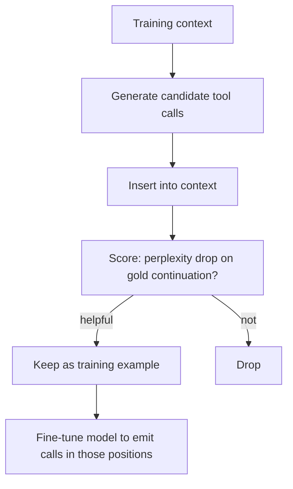

# Toolformer

**Also known as:** Self-Supervised Tool Learning

**Category:** Tool Use & Environment  
**Status in practice:** deprecated

## Intent

Train the model to learn when and how to call tools through self-supervised data, without human annotation.

## Context

A team is deploying tool use at scale and has noticed that prompt-based function-calling — telling the model in the system prompt what tools are available and hoping it calls them well — underperforms in production. They do not have a dataset of human-labelled tool-use traces showing when each tool should have been called and with what arguments, and creating one at scale is not affordable.

## Problem

Prompt-based tool calling is brittle: the model often forgets to call a tool when it should, calls the wrong one, or invents wrong arguments. The natural alternative — supervised fine-tuning on tool-use traces — requires costly human-labelled data the team does not have. They need a way to teach the model when and how to call tools using only self-supervised signals derived from outputs the model can already produce, so that the training data scales without human annotation.

## Forces

- Self-supervised data must distinguish helpful from unhelpful tool calls.
- The training-time tool surface diverges from runtime over time.
- Filtering noise dominates training cost.

## Therefore

Therefore: self-supervise tool-call placement by keeping only insertions that lower perplexity on the gold continuation, so that the model learns when and how to call tools without human-labelled data.

## Solution

Generate candidate tool calls during training. Insert each into a context. Score whether the resulting completion is improved (perplexity drop on the gold continuation). Keep helpful insertions as training data. Fine-tune the model to emit tool calls in those positions.

## Structure

```
Training context --> Generate candidate tool calls --> Insert into context --> Score (perplexity drop on gold continuation) --helpful--> Keep as training example --> Fine-tune model to emit calls there; --not helpful--> Drop
```

## Diagram



## Example scenario

A team wants their model to call a calculator and a search tool reliably without writing thousands of human-labelled tool-use traces. They use Toolformer-style self-supervision: at training time, candidate tool calls are inserted into many contexts and scored by whether the resulting completion's perplexity drops on the gold continuation; helpful insertions become training data. The fine-tuned model learns when and how to call tools without any human annotation.

## Consequences

**Benefits**

- No human-labelled tool-call data required.
- Model learns when not to call tools, not just when to.

**Liabilities**

- Training pipeline complexity.
- Tool surface drift between train and serve.
- Historical: superseded by RLHF-tuned tool-use in frontier models; not productionised at scale.

## Failure modes

- Train-serve tool drift — the tools available at serving time differ from those used to build the training data, and the model calls tools that no longer exist or have changed.
- Weak scoring signal — a perplexity drop on the gold continuation rewards calls that help wording but not correctness, and the model learns to call tools that do not fix its answer.
- Missed positions — the candidate generator never proposes a call where one was needed, so the model never learns to call there.
- Pipeline breakage — the multi-stage data generation fails part-way, and the fine-tune runs on a skewed or partial set.

## What this pattern constrains

Tool use is bound to positions where self-supervised filtering judged the call helpful; ungrounded tool calls are not reinforced.

## Applicability

**Use when**

- Tool use is deployed at scale and prompt-based function-calling underperforms.
- Human-labelled tool-use traces are unavailable.
- Self-supervised data can be generated by inserting candidate tool calls and scoring them.

**Do not use when**

- Prompt-based tool calling already meets accuracy targets.
- Fine-tuning capacity (compute, model access) is unavailable.
- The toolset is too small or unstable to justify fine-tuning.

## Components

- Candidate Generator — produces candidate tool calls at training-time positions in the corpus
- Insertion Step — substitutes the candidate call (and its API result) into the context
- Scoring Function — measures perplexity drop on the gold continuation to judge helpfulness
- Filtered Training Set — retained examples where the inserted call improved the continuation
- Fine-Tuned Model — trained to emit tool calls at the positions the scorer found helpful

## Tools

- Calculator, search engine, calendar, and translator endpoints — the original Toolformer toolset that produces candidate results
- Self-supervised data pipeline — runs candidate generation, insertion, and scoring across the corpus
- Supervised fine-tuning stack (Hugging Face TRL or equivalent) — trains the model on the filtered traces

## Evaluation metrics

- Downstream task lift versus base model — headline value of the self-supervised training
- Tool-call appropriateness rate at inference — how often the fine-tuned model calls tools when it should
- Wrong-argument rate — share of post-fine-tuning calls with invalid or unhelpful arguments
- Filtered-trace yield — fraction of candidate insertions kept after scoring
- Training compute per percentage-point gain — efficiency of the self-supervised pipeline

## Known uses

- **Toolformer paper baseline** _available_
- **Influences modern instruction-tuning of frontier models** _available_

## Related patterns

- _specialises_ **Tool Use**
- _complements_ **Agent Skills**
- _alternative-to_ **Tool Discovery**
- _complements_ **MRKL Systems (Modular Neuro-Symbolic)**

## References

- [Toolformer: Language Models Can Teach Themselves to Use Tools](https://arxiv.org/abs/2302.04761) — Schick, Dwivedi-Yu, Dessì, Raileanu, Lomeli, Zettlemoyer, Cancedda, Scialom, 2023
