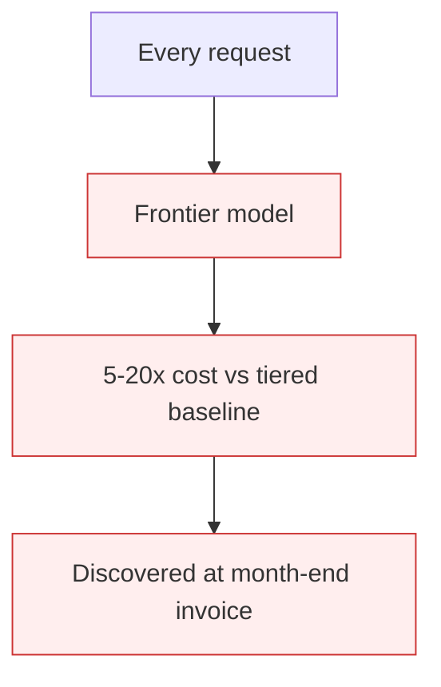

# Top-Tier Model For Everything (Cost)

**Also known as:** Always-Use-The-Best-Model, Frontier-Model Default

**Category:** Anti-Patterns  
**Status in practice:** deprecated

## Intent

Anti-pattern: route every request through the highest-tier model regardless of difficulty, treating cost as a model-choice problem instead of a routing one.

## Context

A team picks the strongest available model (Opus, GPT-5.x) during prototyping for maximum quality. The wrapper defaults are kept in production. Every classification, every extraction, every summarization, every routine reply goes through the most expensive model the team can buy.

## Problem

Cost grows 5–20× compared to a tiered system, with no measurable quality benefit on the easy 80–90% of traffic. The team only notices when the bill arrives. Rationalizations like 'quality matters' or 'simpler to have one model' justify it post-hoc. When budget pressure forces a fix, the team has no telemetry on per-request difficulty and cannot route safely.

## Forces

- Top-tier models are obviously fine for everything; weaker models are not obviously fine.
- Telemetry to measure per-request difficulty does not exist by default; the team has to build it.
- 'Quality matters' is hard to argue against without numbers.

## Therefore

Therefore: route by difficulty — let weak models handle the easy majority, escalate only the hard minority — and gate the escalation with a measurable confidence or complexity signal.

## Solution

Build a routing layer that classifies each request by difficulty (heuristic, classifier, or fast model judgement) and routes to the smallest model that handles its class well. Reserve the top tier for requests escalated by low confidence, high stakes, or explicit user choice. Pair with complexity-based-routing and multi-model-routing. Track cost-per-request as a first-class metric.

## Structure

```
Anti-pattern: Every request -> top-tier model -> high cost on easy traffic. Corrected: Request -> difficulty classifier -> smallest capable model; escalate to top tier on low confidence, high stakes, or user choice -> cost-per-request tracked.
```

## Diagram



## Example scenario

A SaaS app classifies user feedback (positive/negative/feature-request) using GPT-5 with full reasoning. 300k calls per month. Bill: $24k. A simple fine-tuned classifier hits 96% accuracy at $20/month. The team only fixes it after a board cost-review forces the question.

## Consequences

**Benefits**

- Short-term: one top model gives good quality everywhere and avoids building a routing layer.
- Naming it lets a team frame cost as a routing problem and start collecting difficulty data.

**Liabilities**

- 5–20× cost overrun relative to a tiered system with no quality benefit.
- When budget pressure hits, there is no routing telemetry to guide a safe transition.
- Frontier-model defaults entrench faster than they should because they 'just work'.

## Failure modes

- Easy traffic overpaid — simple requests that a small model would answer well all go to the most expensive tier.
- Bill surprise — the team learns of the cost only when the invoice arrives.
- No data to route — when budget pressure comes, there is no per-request difficulty telemetry to guide a safe switch.
- Entrenched default — the top model just works, so the default is never questioned.

## What this pattern constrains

No useful constraint; the missing constraint is per-request difficulty-based routing.

## Applicability

**Use when**

- Never as a steady-state design. Cite when reviewing model defaults.
- Add a difficulty router and reserve the top tier for the hard minority.
- Track cost-per-request as a first-class metric.

**Do not use when**

- Any production agent whose every call goes to the frontier model.
- Any system without per-request difficulty telemetry.
- Any team whose cost grows linearly with traffic without quality reasons.

## Components

- Default model wrapper — points at the top-tier model
- Missing difficulty router — would split easy vs hard requests
- Missing cost-per-request telemetry — would make overspend visible
- Missing cheap-model fleet — alternatives for the easy majority

## Tools

- Detection signal — monitors or audits that surface this anti-pattern in the wild
- Mitigation pattern infrastructure — the positive pattern that resolves this anti-pattern
- Incident-response playbook — what to do when the anti-pattern fires

## Evaluation metrics

- Incident rate — occurrences per period
- Mean time to detection — how long the anti-pattern runs unobserved
- Cost / damage per incident — measurable impact of each occurrence

## Known uses

- **[Zenn: 7つのLLM APIコスト削減アンチパターン](https://zenn.dev/kei_concierge/articles/llm-api-cost-antipatterns-2026)** _available_

## Related patterns

- _alternative-to_ **Complexity-Based Routing**
- _alternative-to_ **Multi-Model Routing**
- _complements_ **Open-Weight Cascade**
- _complements_ **Mixture of Experts Routing**
- _complements_ **Cost Observability**
- _complements_ **Realtime API When Batchable**
- _complements_ **Advisor Consult** — The advisor is a direct remedy for this anti-pattern: frontier-model judgement is kept for decision points instead of being paid for on every turn.

## References

- [LLM APIコスト削減の落とし穴——開発現場で繰り返される7つのアンチパターンと対処法](https://zenn.dev/kei_concierge/articles/llm-api-cost-antipatterns-2026) — 2026
