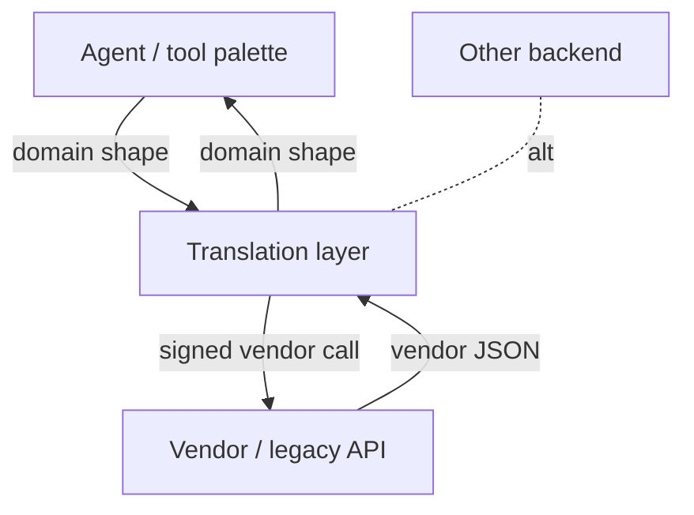

# Translation Layer

**Also known as:** Anti-Corruption Layer, Adapter Pattern (Agentic), API Façade

**Category:** Tool Use & Environment  
**Status in practice:** mature

## Intent

Insert a typed boundary between the agent's clean domain model and a messy or legacy external API.

## Context

A team is building an agent that needs to reason in one shape — a clean domain model that matches the concepts the agent works with — while the underlying data lives in another shape entirely. The real data sits in vendor-specific schemas, legacy APIs with awkward field names, or third-party formats whose structure was decided years ago by another team for entirely different reasons.

## Problem

If the agent sees the raw vendor shape, every prompt fills with field names and structure that have nothing to do with the agent's actual task. Tokens are wasted on irrelevant fields, the model's reasoning gets contaminated by vendor-specific terminology, and any churn in the upstream schema ripples directly into the agent's behaviour. The team needs a typed boundary that translates between the agent-friendly domain model and the vendor shape on each call, so that the agent reasons in clean concepts while the storage layer keeps its existing format.

## Forces

- The legacy shape is authoritative for storage but bad for reasoning.
- Translation must be reversible to write back without data loss.
- Round-tripping costs latency and complexity.

## Therefore

Therefore: insert a typed module that maps vendor JSON into the agent's domain shape on the way in and back into signed vendor calls on the way out, so that the agent sees one clean palette regardless of how messy the upstream APIs are.

## Solution

A translation module sits between the agent's tool palette and the upstream API. Inbound: vendor JSON is mapped into the domain shape. Outbound: domain edits become signed vendor calls. The agent sees one consistent shape regardless of how many backends sit behind it.

## Structure

```
Agent / tool palette --domain shape--> Translation layer --signed vendor call--> Vendor or legacy API --vendor JSON--> Translation layer --domain shape--> Agent
```

## Diagram



## Example scenario

An agent integrates with a legacy ERP whose API returns 47-field nested objects with vendor-specific casing and undocumented enums. Letting these shapes leak into the agent's context wastes tokens and ties the agent's reasoning to upstream churn. The team puts a translation layer between the agent's tool palette and the ERP: inbound vendor JSON maps to a clean domain shape, outbound domain edits become signed vendor calls. The agent sees a small typed surface and the ERP can re-shape its API without breaking the agent.

## Consequences

**Benefits**

- Multiple backends can be swapped behind one tool surface.
- Domain evolution is decoupled from vendor schema changes.

**Liabilities**

- Mapping logic is its own maintenance burden.
- Lossy mappings silently degrade write fidelity if not flagged.

## Failure modes

- Lossy write — a domain edit maps to a vendor call that drops a field the domain model does not have, and the record is quietly damaged.
- Mapping lag — the vendor changes its schema, the translation module is not updated, and reads return empty or wrong domain values.
- Vendor shape leak — an error message or unmapped field passes through raw, and vendor terminology appears in the model's reasoning again.
- Divergent backends — two backends behind the layer map the same domain field slightly differently, and the agent sees inconsistent data.

## What this pattern constrains

Tools see only the domain shape; the vendor shape never reaches the model.

## Applicability

**Use when**

- The agent reasons in one shape (its domain) but data lives in another (vendor schemas).
- Vendor API churn would otherwise leak into the agent's context.
- A typed boundary can be maintained between the agent and upstream APIs.

**Do not use when**

- Only one vendor schema exists and aligns with the agent's needs already.
- The translation layer would add more complexity than it saves.
- Vendor shapes change so often that the translator becomes the bottleneck.

## Components

- Translation Module — sits between the agent's tool palette and the upstream API
- Inbound Mapper — converts vendor JSON into the agent's clean domain shape
- Outbound Mapper — converts domain edits into signed vendor calls
- Domain Schema — canonical typed shape the agent sees regardless of backend
- Vendor Adapter — backend-specific module that knows the legacy API quirks

## Tools

- Schema mapping DSL or library (Zod, Pydantic, JSON Schema transforms) — expresses inbound and outbound mappings
- Vendor SDKs — authenticate and carry the signed calls to the legacy API
- Contract tests — pin the domain shape against representative vendor payloads

## Evaluation metrics

- Domain-shape stability — how often the canonical schema changes despite vendor churn
- Mapping error rate — share of payloads that fail to translate cleanly in either direction
- Tokens per tool result — prompt-side cost of the cleaned domain shape versus raw vendor JSON
- Backend-swap effort — engineer time to add or replace a vendor behind the same domain shape
- End-to-end task success on multi-backend workflows — value of presenting one shape over many

## Known uses

- **Weft** _available_ — WEFT JSON ↔ Ravelry OAuth-signed REST.

## Related patterns

- _complements_ **Polymorphic Record**
- _composes-with_ **Model Context Protocol**
- _complements_ **Schema Extensibility**
- _complements_ **Multilingual Voice Agent Stack**
- _alternative-to_ **Code-Switching-Aware Agent**
- _used-by_ **Provider-String Routing**
- _used-by_ **Unified Voice Interface**
- _complements_ **Direct API Wrapper**

## References

- [Domain-Driven Design (Anti-Corruption Layer)](https://www.domainlanguage.com/ddd/) — Eric Evans, 2003
- [Agent design pattern catalogue: A collection of architectural patterns for foundation model based agents](https://doi.org/10.1016/j.jss.2024.112278) — Yue Liu, Sin Kit Lo, Qinghua Lu, Liming Zhu, Dehai Zhao, Xiwei Xu, Stefan Harrer, Jon Whittle, 2025
