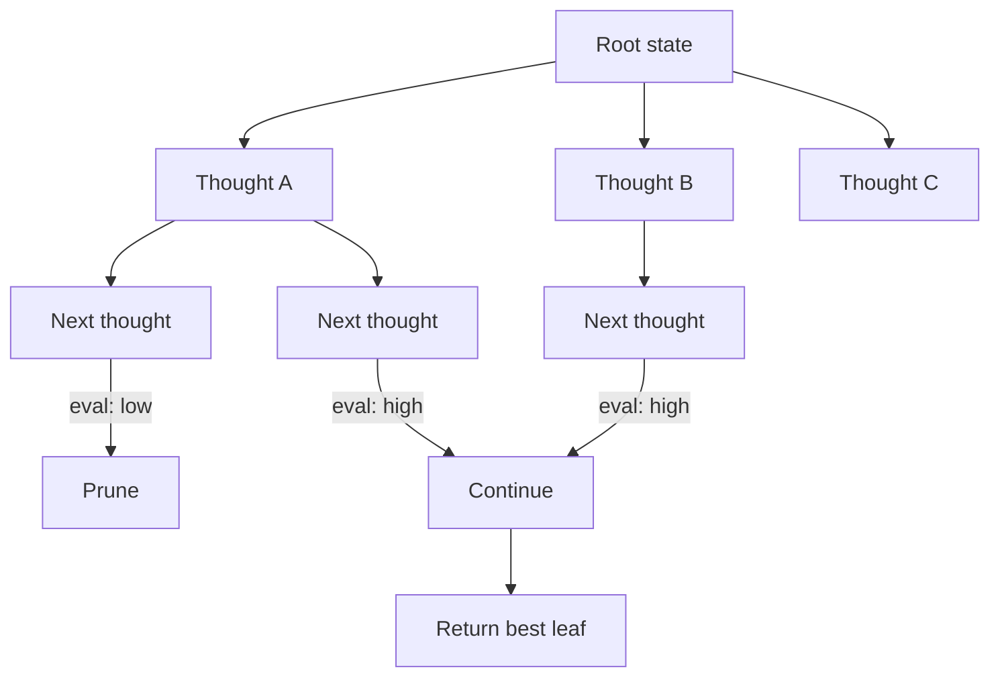

# Tree of Thoughts

**Also known as:** ToT, Deliberate Reasoning

**Category:** Reasoning  
**Status in practice:** emerging

## Intent

Search over a tree of partial reasoning states with explicit lookahead, evaluation, and backtracking.

## Context

A team is solving problems where it pays to consider several candidate next moves before committing to one: small puzzles such as Game of 24 or crosswords, short-horizon planning tasks, or creative writing where opening choices constrain everything that follows. They have already tried plain chain-of-thought and observed that once an early step is wrong, the rest of the chain compounds the mistake instead of recovering.

## Problem

Chain-of-thought produces a single linear reasoning trace and never reconsiders. If the first decision is wrong, the model has no machinery to back up, compare that decision against alternatives, or prune dead-end branches. It cannot weigh several candidate moves against each other at any node, which is exactly what is needed on tasks where the best opening is not obvious. The team needs explicit search vocabulary — lookahead, evaluation, backtracking — layered on top of reasoning so the model can recover from wrong commitments.

## Forces

- Search costs many model calls per problem.
- A value or heuristic function is needed to score partial states.
- Termination criteria are non-trivial.

## Therefore

Therefore: search over a tree of partial reasoning states with evaluation and backtracking, so that dead-end branches are pruned rather than committed to.

## Solution

Decompose the problem into thought steps. At each node, sample several candidate next thoughts. Evaluate each (model self-evaluation or programmatic check). Apply BFS/DFS/beam to explore the tree. Backtrack from dead ends. Return the best leaf.

## Structure

```
Root state --sample k candidate thoughts--> nodes --evaluate (self-eval or programmatic check)--> BFS / DFS / beam expansion --low score--> prune and backtrack | --high score--> expand deeper --> ... --> return best leaf (depth and branching bounded)
```

## Diagram



## Example scenario

A puzzle-solving agent using chain-of-thought commits to its first reasoning trace; when an early step is wrong it cannot recover. The team rebuilds it as Tree of Thoughts: at each node the model samples several candidate next thoughts, evaluates each (model self-eval or programmatic check), and BFS or beam-explores the tree, backtracking from dead ends. Per-problem cost is higher but solve-rate on the harder puzzle class climbs because the agent can compare and unwind.

## Consequences

**Benefits**

- Higher accuracy on tasks where alternatives matter (Game of 24, crosswords, creative writing planning).
- Explicit search vocabulary (lookahead, prune, backtrack).

**Liabilities**

- 5-100x cost over CoT depending on branching factor and depth.
- Value function quality bounds search benefit.

## Failure modes

- Weak value function — the evaluator scores a dead-end branch high, and the search spends its budget there.
- Early pruning — a branch that looks poor at shallow depth is cut, though it was the only path to the answer.
- Cost explosion — branching factor and depth are set loosely, and a task that chain-of-thought could solve costs many times more.
- Shallow commit — the search returns a leaf before any full path was explored, and the answer is a partial state.

## What this pattern constrains

The agent may only commit to a final answer after exploring at least one full path; search depth and branching are bounded by configuration.

## Applicability

**Use when**

- Problems benefit from exploring alternatives rather than committing to one chain (puzzles, planning, creative writing).
- Each thought step can be evaluated by the model or a programmatic check.
- Compute budget allows BFS, DFS, or beam search over thought nodes.

**Do not use when**

- Single-chain reasoning already reaches the answer reliably.
- Step evaluation is unreliable and search would explore noise.
- Latency or cost of search is unacceptable.

## Components

- Thought generator — LLM call that samples several candidate next thoughts at a node
- State evaluator — model self-evaluation or programmatic check that scores a partial state
- Search controller — BFS, DFS, or beam policy that drives expansion and backtracking
- Tree store — node table holding partial states, scores, and parent links
- Termination check — decides when a leaf is final or when search exhausts the budget

## Tools

- LLM API — invoked once per thought expansion and per self-evaluation
- Programmatic checker — domain-specific verifier (game rule, puzzle constraint, code test) used as a value signal where available

## Evaluation metrics

- Solve rate on alternatives-matter tasks — accuracy gain over CoT on puzzles, planning, and creative-writing benchmarks
- Cost multiplier vs CoT — average LLM calls per problem relative to single-chain baseline
- Evaluator agreement with ground truth — how well the value signal ranks states that actually lead to solutions
- Backtrack frequency — share of solves that required at least one dead-end recovery
- Search-depth distribution — typical depth and branching factor at which leaves are returned

## Known uses

- **ToT paper benchmarks (Game of 24, crosswords, creative writing)** _available_
- **LangChain ToT integration** _available_

## Related patterns

- _specialises_ **Chain of Thought**
- _specialises_ **Graph of Thoughts**
- _generalises_ **Language Agent Tree Search**
- _alternative-to_ **Adaptive Branching Tree Search**
- _complements_ **World Model as Tool**
- _alternative-to_ **Single-Path Plan Generator**
- _complements_ **Multi-Path Plan Generator**
- _complements_ **Latent-Space Reasoning** — A continuous thought can encode several next steps at once, a latent analogue of tree-of-thoughts breadth-first exploration.
- _alternative-to_ **Attentive Reasoning Queries** — ARQs narrow reasoning into a fixed checkable sequence rather than searching over branches.

## References

- [Tree of Thoughts: Deliberate Problem Solving with Large Language Models](https://arxiv.org/abs/2305.10601) — Yao, Yu, Zhao, Shafran, Griffiths, Cao, Narasimhan, 2023
- [Agent design pattern catalogue: A collection of architectural patterns for foundation model based agents](https://doi.org/10.1016/j.jss.2024.112278) — Yue Liu, Sin Kit Lo, Qinghua Lu, Liming Zhu, Dehai Zhao, Xiwei Xu, Stefan Harrer, Jon Whittle, 2025
