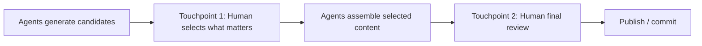

# Two Human Touchpoints

**Also known as:** Curation + Final-Review HITL, Selection-and-Publish Touchpoints

**Category:** Safety & Control  
**Status in practice:** emerging

## Intent

Place exactly two human-in-the-loop checkpoints in agentic pipelines: one at content selection and one at final review before publication.

## Context

A team automates a content or decision pipeline (newsletter, report, recommendation). The temptation is fully-autonomous: agent does everything end-to-end. Result: technically-accurate, on-policy outputs that lack strategic narrative and feel hollow to readers / users — Bornet's 'somehow soulless' observation.

## Problem

Zero-touchpoint pipelines produce outputs missing the human judgment that defines what matters. Adding too many touchpoints destroys the productivity gain (validation burden). The team needs the minimum-and-correct number of human checkpoints.

## Forces

- Each touchpoint adds latency and human-hour cost.
- Too few and the output is soulless; too many and the automation is pointless.
- Touchpoint placement matters as much as count — wrong placement adds cost without quality.

## Therefore

Therefore: place exactly two touchpoints — one at the curation/selection moment (human chooses what matters from agent-produced candidates) and one at the final-review moment (human approves before publication/commit).

## Solution

Insert two human-in-the-loop checkpoints. Touchpoint 1 — Selection: after the agent has produced candidate outputs, a human reviews and selects which ones matter (this captures human judgment about value, relevance, audience fit). Touchpoint 2 — Final Review: before publication or irreversible commit, a human reviews the assembled output for context, accuracy, editorial standards. All other steps are autonomous. Pair with human-in-the-loop, approval-queue, sync-execution-plan-confirmation, three-tier-autonomy-portfolio.

## Structure

```
Agents generate candidates --> Touchpoint 1: human selects what matters --> Agents assemble selected content --> Touchpoint 2: human final review --> Publish / commit; all other steps autonomous
```

## Diagram



## Example scenario

The authors' newsletter pipeline. Zero-touchpoint attempt: fully-automated newsletter is technically accurate but readers' open rates fall and feedback says it feels 'corporate'. With Two Human Touchpoints: agents produce daily summary candidates → human editor selects which to include (Touchpoint 1) → agents compile and format → human editor reviews the assembled newsletter before publication (Touchpoint 2). Open rates recover; productivity gain preserved.

## Consequences

**Benefits**

- Outputs retain the human judgment that makes them feel non-soulless.
- Productivity gain preserved — only two touchpoints, not per-step approval.
- Touchpoint placement is correct: at the moments where human judgment adds the most value.

**Liabilities**

- Two-touchpoint cost still real; not appropriate for very high-volume pipelines.
- Touchpoint discipline must be enforced — drift to zero or to many is the failure mode.
- Domain-dependent: not every pipeline has clean Selection + Final-Review moments.

## Failure modes

- Drift to zero — under time pressure the final review is skipped, and assembled output publishes with no human check.
- Drift to many — extra approvals are added after each mistake, and the validation burden erases the time the agents saved.
- Forced fit — a pipeline with no clear selection moment gets a token touchpoint that reviews nothing of value.

## What this pattern constrains

Exactly two human touchpoints — at Selection and at Final Review — for content / decision pipelines; pipelines may not collapse to zero touchpoints or expand to per-step approval.

## Applicability

**Use when**

- Content / decision pipelines where human judgment about 'what matters' is load-bearing.
- Selection and Final-Review moments are identifiable.
- Pipeline volume allows two human touchpoints per output.

**Do not use when**

- High-volume routine processing (use lower-touchpoint patterns).
- Domains without a meaningful Selection moment.
- Fully-tactical workloads where 'soulless' is fine.

## Components

- Candidate-generation agents
- Touchpoint 1 UI — selection from candidates
- Assembly agents
- Touchpoint 2 UI — final review
- Publish step

## Tools

- Touchpoint 1 UI (Selection)
- Assembly agents
- Touchpoint 2 UI (Final Review)
- Audit trail per touchpoint

## Evaluation metrics

- Touchpoint-1 selection rate (accepted / proposed)
- Touchpoint-2 revision rate
- Soulless-output indicator (engagement / open / NPS)

## Known uses

- **[Bornet et al. — Agentic Artificial Intelligence, Chapter 8 (newsletter automation case, observed 'soulless' outputs without curation touchpoint)](https://www.worldscientific.com/worldscibooks/10.1142/14380)** _available_

## Related patterns

- _specialises_ **Human-in-the-Loop**
- _complements_ **Approval Queue**
- _complements_ **Synchronous Execution-Plan Confirmation**
- _complements_ **One Tool, One Agent**
- _complements_ **Cost-Aware Action Delegation**

## References

- [Agentic Artificial Intelligence — Chapter 8 (newsletter case)](https://www.worldscientific.com/worldscibooks/10.1142/14380) — 2025
