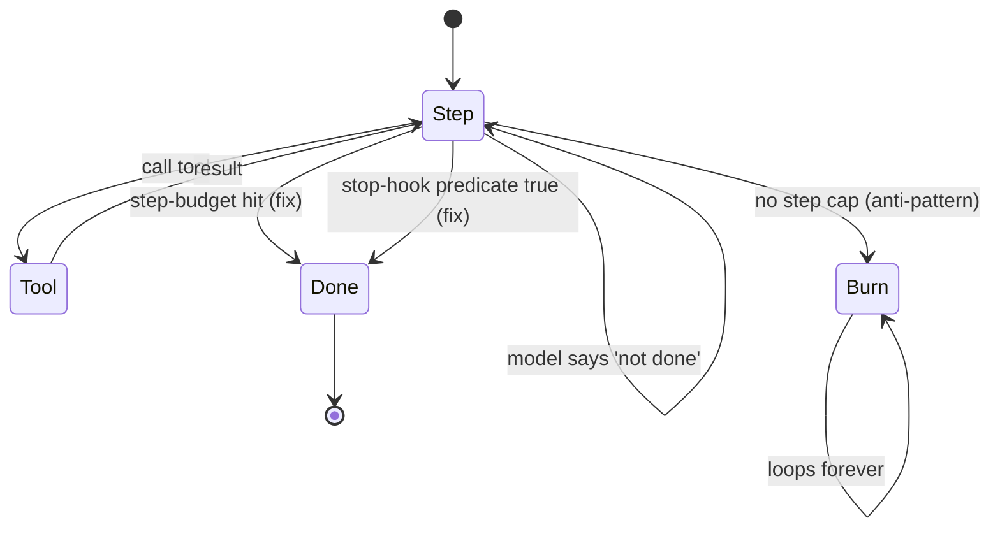

# Unbounded Loop

**Also known as:** No Step Cap, Open-Ended Agent, Agent Stuck, Loops Forever

**Category:** Anti-Patterns  
**Status in practice:** deprecated

## Intent

Anti-pattern: run the agent loop without a step budget and let model self-termination decide.

## Context

A team has implemented an agent loop as 'keep iterating while the model says it is not done', with no external counter, timer, or cost cap to interrupt the loop from outside. The implicit assumption is that the model will say 'done' when the work is complete, and that this self-termination signal is reliable enough to drive the loop's exit.

## Problem

In practice the model rarely declares itself done on hard tasks: it wanders into related questions, retries failed actions, or loops on errors without recognising that it is looping. With no external bound on iterations, total cost, or wall-clock time, the loop can run for hours and burn through significant budget before anyone notices. The user is left waiting while the agent grinds. Picking an exact cap is empirical and feels arbitrary, but no cap at all is worse: the agent will eventually be put in a state where it never terminates on its own, and unbounded cost is the result.

## Forces

- Caps cut off legitimate work.
- Choosing the cap is empirical.
- Model self-termination feels natural until it fails.

## Therefore

Therefore: set a `max_steps` cap and a programmatic stop-hook predicate on the loop, so that termination is decided by construction rather than left to whether the model happens to declare itself done.

## Solution

Don't. Set max_steps. Add a stop hook. See step-budget, the-stop-hook.

## Structure

```
Anti-pattern: Agent loop -> model decides when to stop -> no stop on hard tasks -> unbounded cost and wait. Corrected: Agent loop -> max_steps + stop hook + per-task spend cap -> forced termination with a report.
```

## Diagram



## Example scenario

A team ships an agent without a step budget, trusting the model to decide when to stop. On a flaky network it retries the same tool forever; on an ambiguous task it wanders for forty turns and bills accordingly. The post-mortem is brief: they add `max_steps` and a stop-hook predicate. Cost becomes bounded by construction and the same incident class disappears from the support queue.

## Consequences

**Benefits**

- Short-term: letting the model decide when it is done avoids picking a step cap that feels arbitrary.
- Naming it lets a team treat a missing step budget as a defect, not a tuning choice.

**Liabilities**

- Cost blow-up.
- Silent quality regressions when models drift.

## Failure modes

- Wandering agent — on a hard task the agent drifts into related questions and never declares itself done.
- Error loop — the agent retries the same failing action again and again without noticing it is looping.
- Overnight bill — a run with no step, cost, or time cap keeps going for hours before anyone sees the spend.
- Stuck user — the user waits on a run that has no point at which it is forced to stop and report.

## What this pattern constrains

Avoiding it imposes a hard budget: an agent loop must not rely on model self-termination; max_steps and a stop hook bound every run, and spend is capped per task.

## Applicability

**Use when**

- Cite this entry when loop termination depends solely on the model deciding it is done.
- You are already here if runs occasionally wander for hundreds of steps with unbounded cost.
- Set max_steps, add a stop hook (see step-budget, the-stop-hook), and pair with cost-gating.

**Do not use when**

- Cost or latency must be bounded.
- The model is observed not to declare 'done' reliably.
- Programmatic stop conditions can be defined for the loop.

## Components

- Agent loop — iterates as long as the model says it is not done
- Model self-termination signal — sole exit condition, unreliable on hard or flaky tasks
- Missing external step counter — no `max_steps` interrupts the loop from outside
- Missing stop-hook predicate — no programmatic check that ends the run on convergence or stall

## Tools

- Iteration runner — loops on model output with no externally enforced bound
- Cost or wall-clock cap — missing outer governor that would interrupt the run

## Evaluation metrics

- Steps-per-task distribution — long tails flag runs that never self-terminated
- Wall-clock-per-task tail — share of runs that exceeded the latency SLO before exiting
- Cost-per-task tail — share of runs that exceeded the spend budget before exiting
- Model-said-done accuracy — fraction of self-declared completions that match an external definition of done

## Known uses

- **Early autonomous-agent demos (AutoGPT, BabyAGI initial versions)** _available_

## Related patterns

- _alternative-to_ **Step Budget**
- _alternative-to_ **Stop Hook**
- _conflicts-with_ **Rumination Agent**
- _complements_ **Errors Swept Under the Rug**
- _complements_ **Cascading Agent Failures**
- _complements_ **Demo-to-Production Cliff**
- _complements_ **Token-Economy Blindness**
- _complements_ **Missing max_tokens Cap**
- _alternative-to_ **Naive Retry Without Backoff**
- _alternative-to_ **Composable Termination Conditions**
- _complements_ **Symptom-Remediation Thrashing** — Unbounded-loop is the agent's own reasoning loop with no step budget; symptom thrashing is a cross-incident remediation-to-production loop with no escalate-after-N cap.

## References

- [Building Effective Agents](https://www.anthropic.com/engineering/building-effective-agents) — Anthropic, 2024
