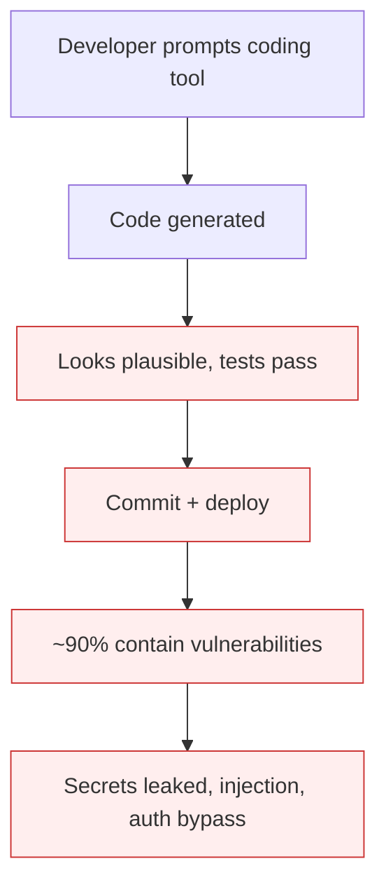

# Vibe-Coding Without Security Review

**Also known as:** Agent-Scaffolded Code Without Audit, Copilot-Authored Agent Deployed

**Category:** Anti-Patterns  
**Status in practice:** deprecated

## Intent

Anti-pattern: developer scaffolds an agent prototype with a code-generation tool and ships the generated code with no security review; ~90% of agent-generated code contains vulnerabilities without explicit security prompts.

## Context

An internal developer uses Copilot, Cursor, or Claude to scaffold a new agent prototype (HTTP wrapper, tool clients, config loading). The output works. The developer commits and deploys without reading line-by-line and without a security review.

## Problem

Generated code routinely contains hardcoded API keys, missing input validation, world-readable file modes, unsanitized SQL, secrets in logs, and missing authentication on internal endpoints. Studies cited in the t3n German press piece put the vulnerability rate near 90% without explicit security prompts. 'It worked' becomes the entire QA. Differs from existing agent-generated-code-rce (which is the runtime attack surface); this is the *shipping* anti-pattern.

## Forces

- Generated code is 'plausible looking' which substitutes for review.
- Agent-scaffolded prototypes feel like throwaways but get shipped.
- Security review is treated as a separate workflow not triggered by scaffolded code.

## Therefore

Therefore: every code path produced by an the agent coding tool that ships to production passes the same security review as human-authored code; AI-scaffolded code is *more* suspicious by default, not less.

## Solution

Treat coding-tool-generated code as untrusted contribution requiring full review. Run static analysis (Semgrep, CodeQL) on all generated code before commit. Require secrets scanning, SQL-injection scanning, and dependency vetting. Prefer security-aware prompting (provide hardening rules in the prompt) but never substitute it for review. Pair with agent-generated-code-rce awareness.

## Structure

```
Anti-pattern: Code-generation tool -> generated code -> "it worked" -> ship -> vulnerabilities in production. Corrected: Generated code (treated as untrusted) -> static analysis + secrets / SQL-injection scanning + dependency vetting + review -> commit.
```

## Diagram



## Example scenario

A developer asks Copilot to scaffold an agent endpoint. The output hardcodes the OpenAI key in source, has no auth on the /agent/run route, and logs full request bodies including PII. The developer reviews the test passes and merges. The repo is mirrored to a public GitHub for backup. The key is exfiltrated within 4 hours.

## Consequences

**Benefits**

- Short-term: shipping generated code that runs saves the time a security review would take.
- Naming it lets a team treat generated code as an untrusted contribution with a required review gate.

**Liabilities**

- Hardcoded secrets and credentials shipped to production repos.
- Standard injection vulnerabilities at agent endpoints.
- Audit failures when AI-scaffolded code is reviewed retroactively.

## Failure modes

- Shipped secret — generated code with a hardcoded API key is committed and pushed to production.
- Open endpoint — an internal endpoint generated without authentication is exposed with the agent prototype.
- Injection hole — unsanitized SQL and missing input validation reach production because the code ran once.
- Audit surprise — a later review of the generated code finds many vulnerabilities at once.

## What this pattern constrains

No useful constraint; the missing constraint is mandatory security review of coding-tool-scaffolded code.

## Applicability

**Use when**

- Never. Cite when reviewing scaffolded code shipped without security review.
- Run static analysis and secrets scanning on all generated code before commit.
- Treat scaffolded code as untrusted contribution by default.

**Do not use when**

- Any scaffolded code in production without security review.
- Any agent endpoint scaffolded by a coding tool without authentication review.
- Any team without static-analysis gates on AI-generated commits.

## Components

- Coding-tool scaffolder — produces plausible but unaudited code
- Developer — does not review line-by-line
- Missing security review — does not gate AI-scaffolded code
- Missing static-analysis pipeline — would catch most issues automatically

## Tools

- Detection signal — monitors or audits that surface this anti-pattern in the wild
- Mitigation pattern infrastructure — the positive pattern that resolves this anti-pattern
- Incident-response playbook — what to do when the anti-pattern fires

## Evaluation metrics

- Incident rate — occurrences per period
- Mean time to detection — how long the anti-pattern runs unobserved
- Cost / damage per incident — measurable impact of each occurrence

## Known uses

- **[t3n: KI-Agenten scheitern nicht am Modell](https://t3n.de/news/ki-agenten-scheitern-an-architekturfehlern-1730278/)** _available_

## Related patterns

- _complements_ **Agent-Generated Code RCE**
- _complements_ **Agentic Supply Chain Compromise**
- _complements_ **Secrets Handling**
- _complements_ **Code Execution**
- _complements_ **Shadow AI**

## References

- [KI-Agenten scheitern nicht am Modell](https://t3n.de/news/ki-agenten-scheitern-an-architekturfehlern-1730278/) — 2026
