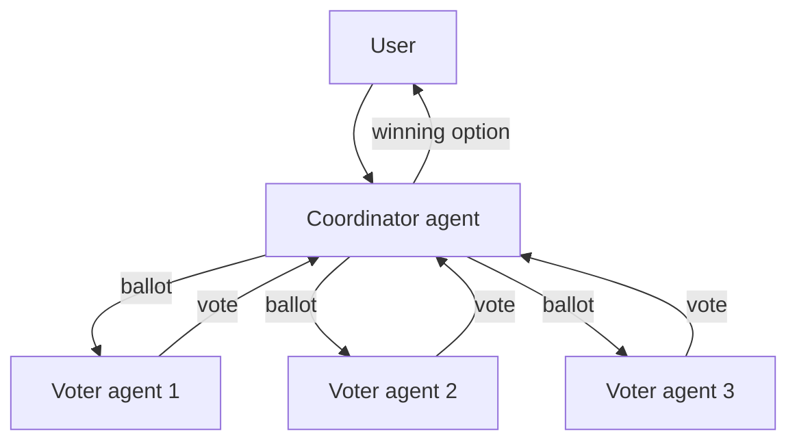

# Voting-Based Cooperation

**Also known as:** Multi-Agent Voting, Agent Consensus by Vote, Inter-Agent Election

**Category:** Multi-Agent  
**Status in practice:** emerging

## Intent

Finalise a decision across multiple agents by collecting and tallying their votes on candidate options, so the joint output reflects collective rather than single-agent judgement.

## Context

A team is running a multi-agent system in which several agents — possibly using different models, different prompts, or different perspectives — produce candidate answers or evaluations on the same task. The system needs to return a single decision, but the agents do not necessarily agree, and the team wants the combined answer to reflect the group rather than whoever happens to speak first.

## Problem

Picking any one agent's output as the final answer throws away the diversity of the rest, which was the whole reason for running several agents in the first place. Running an unstructured debate between the agents may not converge within a reasonable budget and offers no clean record of how the final decision was reached. The team needs an explicit procedure that aggregates the agents' opinions fairly, terminates predictably, and leaves an auditable trace showing which agent voted for which option.

## Forces

- Diversity: agents may disagree on a plan or solution; that diversity is the value.
- Fairness: the procedure must respect each participating agent's standing.
- Accountability: a vote leaves a traceable record of who chose what.
- Centralisation risk: voting can entrench whichever agents dominate the electorate.

## Therefore

Therefore: have agents express opinions as votes on a shared candidate set, tally the votes through a defined mechanism (majority, weighted, ranked) and return the winning option as the agreed decision, so disagreement is resolved by procedure rather than by an arbitrary choice.

## Solution

A coordinator agent collects candidate answers (or reflective suggestions) from a set of worker agents, presents them as a ballot to additional voter agents, and tallies the votes — by majority count, average score, weighted by role, or via a smart-contract / blockchain mechanism for tamper-evidence. Identity management of voters is significant for auditability. Voting-based cooperation can be combined with role-based or debate-based cooperation as a closing step.

## Structure

```
Coordinator agent → ballot {candidate options} → Voter agents (Agent-as-a-worker × N) → tallied result → Coordinator → User.
```

## Diagram



*A coordinator collects votes from agent voters and returns the winning option.*

## Example scenario

A medical-triage system runs three specialist agents (cardiology, neurology, pulmonology) over the same patient summary. Each emits a recommended next test. A coordinator presents the three options to five voter agents (general internists) who rank them; the winning option is returned to the clinician, with the full ballot saved for audit.

## Consequences

**Benefits**

- Fairness: votes can be weighted to reflect roles, expertise, or stake.
- Accountability: the full voting record is auditable after the fact.
- Collective intelligence: combines the strengths of multiple agents and reduces single-agent bias.

**Liabilities**

- Centralisation: dominant agents can gain disproportionate decision rights.
- Overhead: hosting a vote adds communication and coordination cost.
- Strategic voting: agents may game the procedure if rewards depend on outcomes.

## Failure modes

- Dominant voter — one agent or role carries extra weight, and the tally reflects its view rather than the group's.
- Strategic voting — voters whose rewards depend on the outcome vote to game the result instead of for the best option.
- Vote overhead — collecting and tallying ballots costs more than the decision is worth on a simple question.
- Unknown voter — voter identities are not managed, so the tally cannot be audited or a voter counts twice.

## What this pattern constrains

No single agent's output may be returned as final; only the option that wins the tally is the agreed decision.

## Applicability

**Use when**

- Multiple agents have diverse, defensible opinions and one decision must be returned.
- Audit-grade traceability of how the decision was reached is required.
- Voting weights or eligibility can be defined per role or stake.

**Do not use when**

- Agents are near-duplicates and would all vote the same way — self-consistency is cheaper.
- Iterative refinement is more useful than a discrete election — use debate or evaluator-optimizer.
- Convergence is more important than diversity (single specialist + critic may suffice).

## Components

- Coordinator agent — collects candidate options, presents the ballot, and tallies the votes
- Worker agent — produces a candidate answer that becomes a ballot option
- Voter agent — expresses a preference over the ballot, identifiable for audit
- Tally mechanism — majority count, weighted average, ranked-choice, or smart-contract scheme
- Voter identity registry — auditable mapping of which voter cast which vote

## Tools

- Heterogeneous LLM APIs — different models for workers and voters increase opinion diversity
- Ballot store — persistent record of options and per-voter choices for after-the-fact audit
- Optional smart-contract or blockchain layer — tamper-evident tally for high-stakes votes

## Evaluation metrics

- Vote-agreement rate — share of decisions where the winning option exceeded a majority threshold
- Outcome lift over single-agent baseline — does collective tally beat one specialist
- Strategic-voting indicators — voter behaviour patterns suggesting outcome-gaming
- Ballot-audit completeness — share of decisions whose voting record fully reconstructs
- Per-decision overhead — extra inference and coordination cost versus picking one agent

## Known uses

- **Hamilton (2023)** _available_ — Nine agents simulate a court where decisions are determined by the dominant voting result.
- **ChatEval (Chan et al. 2024)** _available_ — Agents reach consensus on user prompts via majority vote or average score.
- **Yang et al. (2024b)** _available_ — Studies alignment of agent voters (GPT-4, LLaMA-2) against human voters on 24 urban projects.

## Related patterns

- _alternative-to_ **Debate**
- _composes-with_ **Role Assignment**
- _generalises_ **Self-Consistency**
- _alternative-to_ **Best-of-N Sampling**
- _complements_ **Evaluator-Optimizer**
- _uses_ **Tool/Agent Registry**
- _alternative-to_ **Parallel Fan-Out / Gather**
- _generalises_ **Heterogeneous-Model Council with Synthesis Judge**
- _complements_ **Consensus-Averaging Over Expertise** — Voting tallies discrete votes; consensus-averaging blends views into a compromise that dilutes the known expert below their solo performance.
- _complements_ **Epistemic Fault-Domain Quorum** — That pattern defines how ballots are collected and tallied; this one decides whether the ballots were causally independent enough for the tally to carry the meaning assigned to it.

## References

- [Agent design pattern catalogue: A collection of architectural patterns for foundation model based agents](https://doi.org/10.1016/j.jss.2024.112278) — Yue Liu, Sin Kit Lo, Qinghua Lu, Liming Zhu, Dehai Zhao, Xiwei Xu, Stefan Harrer, Jon Whittle, 2025
- [ChatEval: Towards Better LLM-based Evaluators Through Multi-Agent Debate](https://arxiv.org/abs/2308.07201) — Chi-Min Chan et al., 2024
- [The Wisdom of Crowds: Why the Many Are Smarter Than the Few](https://www.penguinrandomhouse.com/books/175380/the-wisdom-of-crowds-by-james-surowiecki/) — James Surowiecki, 2004
