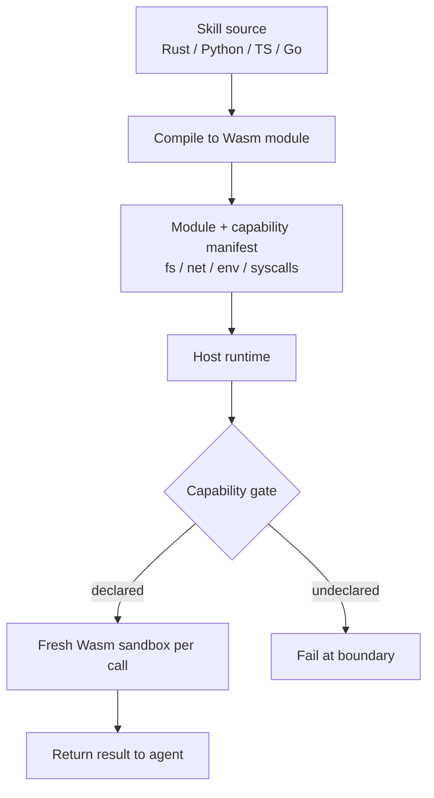

# WebAssembly Skill Runtime

**Also known as:** Wasm Cognitive Skills, Polyglot Skill Sandbox, Capability-Sandboxed Tool Plane

**Category:** Tool Use & Environment  
**Status in practice:** experimental

## Intent

Package each agent skill as a WebAssembly module with a capability manifest, and run it inside a Wasm runtime that enforces those capabilities, so untrusted skills cannot weaken the host's sandbox.

## Context

A team is operating an enterprise agent platform that must accept skills authored by external users or partners and execute them on shared infrastructure. The skills are written in different languages — Rust, Python compiled to a runnable form, TypeScript, Go — and the platform has to enforce per-skill limits on CPU, memory, network access, and filesystem access while still serving them at the rate of incoming agent requests.

## Problem

Running third-party skills as plain in-process code gives them the host's full privileges, which is unacceptable when the author is not fully trusted. Language-specific sandboxes such as a Python sandbox have a long history of escape vulnerabilities and only cover one language at a time. Spinning up a full container per skill invocation is too slow at request rate and too heavy on infrastructure. The team needs a sandbox that is light enough to start per request, language-agnostic enough to cover the polyglot skill set, and strict enough that a hostile skill cannot weaken the host environment.

## Forces

- Skills authored by partners cannot be trusted with host privileges.
- Per-request container start-up is too slow and too expensive.
- Polyglot authoring is a real requirement; Python-only is restrictive.
- Capability declarations have to be checkable, not advisory.

## Therefore

Therefore: ship each skill as a Wasm component with a capability manifest the runtime enforces per call, so that partner-authored or untrusted skills cannot widen the host's sandbox and a fresh isolate spins up faster than a container.

## Solution

Define a Wasm Component Model interface for skills: each skill compiles to a Wasm module and ships with a manifest declaring (filesystem paths, network hosts, env vars, syscalls) it needs. The host runtime instantiates a fresh sandbox per call with only those capabilities. Skills can be authored in any language compiling to Wasm. The host treats the manifest as the contract; missing-capability calls fail at the boundary.

## Structure

```
Host runtime { capability gate } -> Wasm sandbox(skill_module, manifest) -> deterministic IO -> result.
```

## Diagram



## Example scenario

A team wants to let the community contribute third-party skills to their agent but plain-process tools share the host's privileges and per-skill containers are too heavy. They define a Wasm Component Model interface for skills: each compiles to a Wasm module shipped with a manifest declaring filesystem paths, network hosts, env vars, and syscalls it needs. The Wasm runtime enforces those capabilities. Untrusted skills can run safely alongside trusted ones because a misbehaving skill cannot weaken the host's sandbox.

## Consequences

**Benefits**

- Polyglot skill ecosystem with one runtime.
- Strong capability isolation; manifest is the audit surface.
- Wasm cold-start is fast enough to run per request.

**Liabilities**

- Wasm ecosystem maturity per language varies (Rust strong, Python heavier).
- Capability manifest design is the real engineering problem.
- Some workloads (GPU, large data) don't fit Wasm well.

## Failure modes

- Over-broad manifest — a skill declares more paths or hosts than it needs, the runtime grants them, and a hostile skill uses the extra access.
- Manifest drift unnoticed — the skill's code starts needing a capability its manifest lacks, and calls fail at the boundary in production instead of at load.
- Poor language fit — a skill written in a language with a heavy Wasm toolchain starts slowly, and per-call instantiation misses the request budget.
- Workload mismatch — a GPU or large-data skill is forced into Wasm and either fails or runs far too slowly.

## What this pattern constrains

A skill may not exercise any capability not declared in its manifest; manifest drift is detected at load time.

## Applicability

**Use when**

- Enterprise platforms must accept user- or partner-authored skills in multiple languages.
- Per-skill capabilities (filesystem, network, env, syscalls) must be enforced.
- Per-call container overhead is too heavy for request-rate execution.

**Do not use when**

- All skills are first-party and trusted.
- Wasm tooling for the target languages is not mature enough for the workload.
- A simpler sandbox already meets the threat model.

## Components

- Wasm Module — skill compiled to a WebAssembly Component Model artefact
- Capability Manifest — declares filesystem paths, network hosts, env vars, and syscalls the skill needs
- Wasm Host Runtime — instantiates a fresh sandbox per call with only the declared capabilities
- Capability Gate — rejects calls requesting undeclared capabilities and surfaces a typed error
- Skill Toolchain — compiles Rust, Python, TypeScript, or Go sources to Wasm modules plus manifests

## Tools

- WebAssembly runtime (Wasmtime, Wasmer) — executes the modules under the declared capabilities
- WASI Preview 2 (Component Model) — standardises the host-skill interface across languages
- Per-language Wasm toolchains (cargo, py2wasm, AssemblyScript, TinyGo) — produce the modules

## Evaluation metrics

- Capability-gate enforcement rate — share of undeclared-capability calls correctly rejected
- Per-call sandbox cold-start latency — cost of instantiating a fresh Wasm sandbox per call
- Escape incidents — confirmed or attempted breaches of the Wasm boundary (should be zero)
- Manifest accuracy — fraction of skills whose declared capabilities match observed needs
- Cross-language skill share — count of skills authored in each source language as a portability signal

## Known uses

- **[Aleph Alpha PhariaEngine](https://github.com/Aleph-Alpha/pharia-engine)** _available_ — Cognitive Business Units (Skills) compile to Wasm and run inside the engine's sandboxed runtime.

## Related patterns

- _specialises_ **Sandbox Isolation**
- _complements_ **Skill Library**
- _complements_ **Tool Discovery**
- _complements_ **Secrets Handling**
- _complements_ **Code Execution**

## References

- [Aleph-Alpha/pharia-engine — Serverless AI powered by WebAssembly](https://github.com/Aleph-Alpha/pharia-engine)
