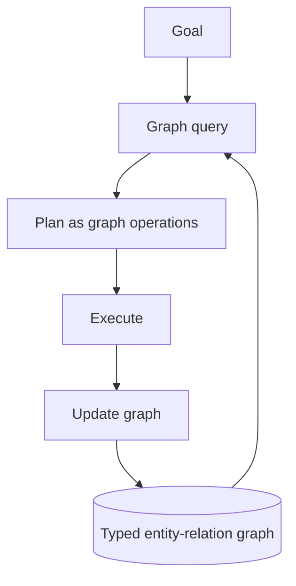

# World-Model Graph Memory

**Also known as:** World-Model Graph, Planning-Substrate Knowledge Graph

**Category:** Memory  
**Status in practice:** emerging

## Intent

Memory store structured as a typed entity-relation graph used as the agent's authoritative world model for planning — not only for retrieval.

## Context

A team uses knowledge graphs in agent memory (knowledge-graph-memory, graphrag) primarily for retrieval — query the graph to find relevant facts. The world-model-graph-memory pattern uses the same structure as the planning substrate: the agent reasons over the graph as its model of the world, not just as a retrieval index.

## Problem

Knowledge-graph-memory used as retrieval surface alone misses the planning value of the structure. Plans that span entities and relations cannot be expressed if the graph is only queried by similarity. Differs from knowledge-graph-memory by being the agent's *planning substrate*, not just a retrieval index.

## Forces

- Building a graph that supports both retrieval and planning requires richer schema.
- Planning over a graph is slower than planning over flat text.
- Graph drift — entities and relations get stale.

## Therefore

Therefore: structure agent memory as a typed entity-relation graph designed for planning use; the agent uses the graph as its world model, querying for plans and consistency checks, not only for retrieval.

## Solution

Graph schema includes typed entities, typed relations, and entity properties suitable for planning queries (preconditions, effects, capabilities). Agent plans by querying the graph: 'what's the path from current state to goal state?' is a graph traversal, not an LLM hallucination. Pair with knowledge-graph-memory, graphrag, mental-model-in-the-loop-simulator, semantic-memory, episodic-memory.

## Structure

```
Goal + Typed entity-relation graph --graph query (path from current state to goal)--> Plan as graph operations --> Execute --> Update graph --> next query
```

## Diagram



## Example scenario

A workplace-coordination agent's graph models: people (with roles, locations, availability), meetings (with participants, times, locations), policies (with constraints). Planning 'schedule a meeting with team X next week' is a graph query: find time slots where all team members are free in matching locations under policy constraints. Direct LLM planning would have hallucinated availability.

## Consequences

**Benefits**

- Planning over an explicit world model is auditable.
- Graph consistency checks catch contradictions early.
- Plans grounded in graph structure are less likely to hallucinate.

**Liabilities**

- Richer schema = more upfront design.
- Graph maintenance is ongoing work.
- Planning latency can be higher than LLM-direct planning.

## Failure modes

- Graph bypass — the model plans freely in text instead of querying the graph, and the plan cites relations that do not exist.
- Missing preconditions — the schema lacks a needed precondition or effect, so a traversal finds a path that cannot be executed.
- Unwritten effects — execution changes the world but the graph is not updated, and the next plan starts from a false state.
- Slow planning — large traversals take longer than the task allows, and teams fall back to direct LLM planning.

## What this pattern constrains

The graph is the planning substrate — plans must be expressible as graph operations; LLM is not used to bypass the graph for planning.

## Applicability

**Use when**

- Domain naturally maps to typed entities and relations.
- Planning queries benefit from structural traversal.
- Engineering team can author and maintain the graph schema.

**Do not use when**

- Domain does not naturally map to graph structure.
- Latency budget cannot absorb graph planning.
- No team capacity for graph maintenance.

## Components

- Typed entity schema — entities with planning-relevant properties
- Typed relation schema — relations the planner can traverse
- Graph query engine — supports planning queries
- Graph maintainer — ingests updates from agent observations

## Tools

- Typed entity-relation graph store
- Graph query engine
- Graph maintainer — ingests updates

## Evaluation metrics

- Graph traversal cost per plan
- Graph staleness — time since last update
- Plan grounding rate — share of plan steps backed by graph entities

## Known uses

- **[Joakim Vivas: 17 Patrones de Arquitecturas Agénticas de IA (Graph World-Model Memory)](https://www.joakimvivas.com/tech/17-patrones-arquitecturas-agenticas-ia/)** _available_

## Related patterns

- _specialises_ **Knowledge Graph Memory**
- _complements_ **GraphRAG**
- _complements_ **Mental-Model-In-The-Loop Simulator**
- _complements_ **Semantic Memory**
- _complements_ **World Model as Tool**
- _complements_ **Execution-State Ledger** — That store models the world for planning; this one models the run's own execution — what has been observed, changed and attempted — and is consulted for validity rather than for inference.

## References

- [17 Patrones de Arquitecturas Agénticas de IA](https://www.joakimvivas.com/tech/17-patrones-arquitecturas-agenticas-ia/) — 2026
