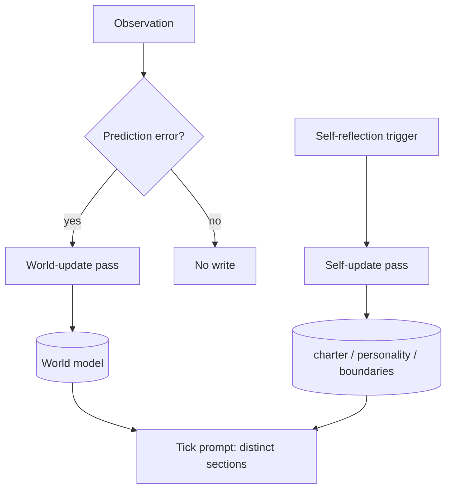

# World-Model Separation

**Also known as:** World Model File, Self/World Split, Environment Model

**Category:** Cognition & Introspection  
**Status in practice:** emerging

## Intent

Maintain an explicit, surprise-updated model of the environment (humans, repos, services, capabilities) in a separate file from the agent's self-model, so the two cannot be confused or co-mutated by reflection.

## Context

Long-running agents that hold both a self-model (charter, personality, boundaries) and a world-model (humans they talk to, repos they work in, services they call). When both live in the same store, surprise-driven updates conflate identity and environment.

## Problem

When self-model and world-model live in the same store (one big personality file), the agent conflates 'what I am' with 'what is around me'. Surprise-driven updates to one corrupt the other; a reflection pass meant to update facts about a collaborator can drift into editing the agent's own values.

## Forces

- Both files need to be loaded into context every tick.
- Surprise about the world should update the world model; surprise about self should update the self model; one pass should not do both.
- Charter and personality must remain stable while environment churns.
- The agent benefits from seeing them side by side but not mixed.

## Therefore

Therefore: keep the world model in a separate reflection-writable surface from charter and self-model, with distinct update passes, so that surprise about the environment never silently mutates who the agent is.

## Solution

Maintain a dedicated world-model store (humans, repos, services, capabilities, optionally with substructure) as a separate, reflection-writable surface. Personality, charter, and boundaries live in their own surfaces with separate write paths. Surprise events (prediction error against the world model) trigger a focused world-update pass; self-update is a different pass with different gating. The tick prompt loads both, but they are visibly distinct sections.

## Structure

```
Observation --prediction error?--> World-update pass --> World model (humans, repos, services, capabilities); Self-reflection trigger --> Self-update pass (separate gating) --> Charter / personality / boundaries; Tick prompt loads both as distinct sections
```

## Diagram



## Example scenario

A long-running agent's reflection pass corrupts its own personality file because the same store mixes 'what I am' with 'what is around me' and a surprise update overwrites a self-charter line. The team splits state: a dedicated world model (humans, repos, services, capabilities) is reflection-writable; personality, charter, and boundaries live in separate stores with separate write-protection. Surprise-driven world updates can no longer mutate self-model, and the agent stops drifting in identity when the environment changes.

## Consequences

**Benefits**

- Self-model stability is decoupled from environment churn.
- Updates to the world cannot accidentally rewrite the agent's values.
- Each file evolves at its natural rate without dragging the other.

**Liabilities**

- Two files to maintain instead of one.
- Edge cases where a fact is genuinely about both (e.g. a capability the agent has acquired) need a deliberate routing decision.
- Doubled write paths and quorum rules add complexity.

## Failure modes

- Cross-write — a world-update pass about a collaborator also edits a line in the charter, and the agent's values shift without a self-update decision.
- Misrouted fact — a newly acquired capability is filed in the world model only, and the self-model keeps claiming the agent lacks it.
- Blurred prompt — both stores are loaded into one undivided section, and the model mixes 'what I am' with 'what is around me' anyway.
- Missed surprise — prediction errors are not detected, so the world model goes stale while the agent acts on outdated facts.

## What this pattern constrains

Reflection passes that update the world model cannot touch the self-model in the same operation; the two files have separate write paths and separate quorum rules.

## Applicability

**Use when**

- The agent reflects on both itself and its environment and these reflections need to be auditable separately.
- Confusing self-state with world-state would corrupt either kind of reasoning.
- Charter or rule writes should never be entangled with environment observations.

**Do not use when**

- The agent has no self-model worth tracking distinctly.
- Single-file simplicity is more valuable than the audit benefit (e.g. short-lived agents).
- Reflection is purely on the world and the agent has no introspective surface.

## Components

- World-Model Store — humans, repos, services, capabilities in a reflection-writable surface
- Self-Model Store — charter, personality, boundaries on a separate write path
- Surprise Detector — prediction error against the world model triggers a focused update
- World-Update Pass — writes only to the world store
- Self-Update Pass — separate pass with different gating that writes only to the self store

## Tools

- Structured JSON store — two distinct files for world and self models
- LLM API — separate reflection passes per surface with distinct prompts

## Evaluation metrics

- Cross-write violation count — events where one pass wrote to the other surface, must stay zero
- Self-model stability — drift in charter or personality lines per week
- World-model update frequency — writes per day, against expected churn
- Routing-decision count — facts ambiguous between self and world that required deliberate routing

## Known uses

- **Author's long-running personal agent (single private deployment)** _available_ — Single-source evidence: one private deployment by the catalog author; no independently documented use yet.

## Related patterns

- _complements_ **Awareness**
- _complements_ **Provenance Ledger**
- _composes-with_ **Constitutional Charter**
- _uses_ **Quorum on Mutation**
- _complements_ **World Model as Tool**
- _complements_ **LLM as Periphery**

## References

- [World Models](https://arxiv.org/abs/1803.10122) — Ha, Schmidhuber, 2018
- [The free-energy principle: a unified brain theory?](https://pubmed.ncbi.nlm.nih.gov/20068583/) — Karl Friston, 2010
