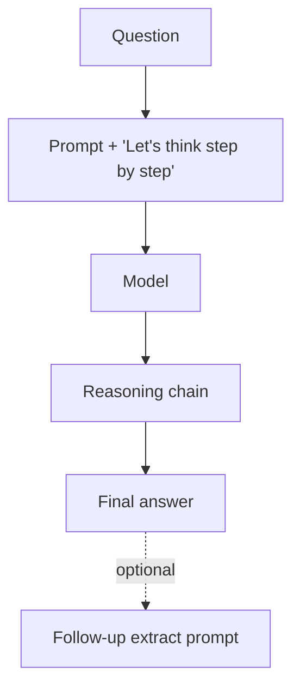

# Zero-Shot Chain-of-Thought

**Also known as:** Let's Think Step by Step, Trigger-Phrase CoT

**Category:** Reasoning  
**Status in practice:** mature

## Intent

Elicit step-by-step reasoning with a single trigger phrase rather than few-shot exemplars.

## Context

A team is building prompts for many different reasoning tasks — dozens or hundreds — where writing carefully crafted few-shot examples with full chain-of-thought traces would be expensive in effort and would have to be redone each time the task changes. They want something close to chain-of-thought quality but without paying the per-task curation cost for every new task type.

## Problem

Few-shot chain-of-thought needs a small set of worked examples for every distinct task; the work of writing and maintaining those examples does not scale across a large portfolio of tasks or a fast-changing product. Without exemplars, however, plain prompting collapses the reasoning into a single output token and quality drops sharply. The team needs a way to trigger step-by-step reasoning that does not depend on supplying task-specific worked solutions in the prompt.

## Forces

- Trigger phrases are model- and language-specific.
- Quality lift is smaller than well-curated few-shot CoT.
- Trigger-phrase reasoning can drift on complex tasks.

## Therefore

Therefore: append a single trigger phrase to the prompt, so that reasoning emerges without few-shot exemplars when curated demos are unavailable.

## Solution

Append a trigger phrase ('Let's think step by step', 'Let's work through this carefully') to the prompt. The model produces reasoning before its answer with no exemplar required. Optionally extract the final answer with a follow-up prompt.

## Structure

```
Question + trigger phrase ('Let's think step by step') --> Model --> reasoning chain --> final answer --optional--> follow-up extraction prompt --> extracted answer
```

## Diagram



## Example scenario

A team is building agent prompts for fifty different tasks and writing few-shot CoT exemplars per task is unaffordable. They append a single trigger phrase ('Let's think step by step') to each prompt; the model produces reasoning before its answer with no exemplars required. Quality on multi-step tasks climbs immediately; for the few tasks where zero-shot CoT is not enough, they reach for few-shot or self-consistency on top.

## Consequences

**Benefits**

- Zero curation cost per task.
- Generalises across task types.

**Liabilities**

- Lower quality lift than well-tuned few-shot CoT.
- Trigger-phrase brittleness.

## Failure modes

- Trigger brittleness — a slight rewording of the trigger phrase changes how much the model reasons, and quality varies between prompts.
- Unstructured trace — with no exemplar, the reasoning takes a form the answer extractor does not expect, and the wrong value is pulled out.
- Shallow lift — on tasks where few-shot exemplars would guide the steps, the generic trigger produces reasoning that misses the method.

## What this pattern constrains

The model is required to reason before answering; one-shot answer-only generation is not the target.

## Applicability

**Use when**

- Reasoning tasks where curating few-shot exemplars is impractical or costly.
- A trigger phrase reliably elicits useful chains for the task domain.
- Latency budget allows the model to produce reasoning before the answer.

**Do not use when**

- Few-shot exemplars are available and yield meaningfully better reasoning.
- The trigger phrase produces noisy or irrelevant chains for the task.
- Latency budget forbids the longer reasoning output.

## Components

- LLM — produces the reasoning chain and final answer
- Trigger phrase — fixed instruction such as 'Let's think step by step' appended to every prompt
- Optional answer extractor — second LLM call that pulls the final answer out of the reasoning chain

## Tools

- LLM API — one inference call per question, or two when the answer-extract follow-up is used

## Evaluation metrics

- Accuracy lift over direct prompting — gain attributable to the trigger phrase per task class
- Quality gap vs curated few-shot CoT — accuracy delta against well-tuned exemplar prompts on the same tasks
- Trigger-phrase robustness — variance in accuracy across paraphrases of the trigger
- Reasoning-step presence rate — fraction of outputs that actually produce a chain before the answer
- Token-cost overhead — extra output tokens introduced by the chain vs answer-only prompting

## Known uses

- **Zero-Shot CoT paper baseline** _available_

## Related patterns

- _specialises_ **Chain of Thought**

## References

- [Large Language Models are Zero-Shot Reasoners](https://arxiv.org/abs/2205.11916) — Kojima, Gu, Reid, Matsuo, Iwasawa, 2022
